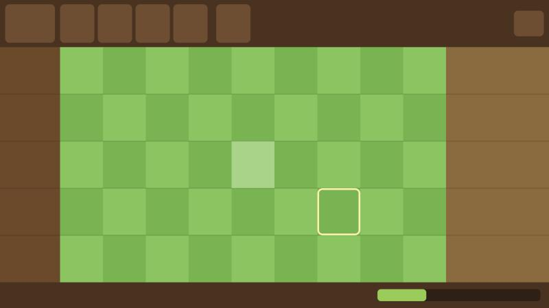

# 🌰 숲 지키기 (Forest Keepers)

숲속 동물들이 레인을 따라 몰려오는 귀여운 슬라임·정령으로부터 숲을 지키는 2D 레인 디펜스 게임이에요.
도토리를 모아 다람쥐·여우·거북이·스컨크를 칸에 배치하고, 몬스터가 왼쪽 둥지에 닿지 못하게 막아요.

> **개발 중** — 지금은 2단계(화면과 그리드)까지 끝났어요. 진행 상황은 [TODO.md](TODO.md)에서 볼 수 있어요.

| | |
|---|---|
| 엔진 | Flutter 3.44 + [Flame](https://flame-engine.org) 1.38 |
| 플랫폼 | Windows · 웹 · Android |
| 공개 예정 | PWA(GitHub Pages) · Microsoft Store |



## 실행하기

Flutter 3.44 이상이 필요해요.

```bash
flutter pub get
```

```bash
flutter run -d windows
```

```bash
flutter run -d chrome
```

```bash
flutter test
```

## 폴더 구조

```
lib/
  main.dart                 앱 진입점 (GameWidget)
  game/
    forest_game.dart        게임 루트, 1280×720 고정 해상도 카메라
    config.dart             모든 수치 (칸 크기, 위치, 색)
    grid.dart               칸 ↔ 화면 좌표 변환
    components/             배경, 필드 입력, (예정) 유닛·몬스터·투사체
    hud/                    HUD (지금은 자리 표시)
test/                       좌표 변환·입력 경로 테스트
tools/make_todo_html.py     TODO.md·WORKLOG.md → HTML
preview/                    단계별 캡처 (preview.html에서 모아 봄)
```

## 문서

| 문서 | 내용 |
|---|---|
| [plan.md](plan.md) | 개발 계획서: 레이아웃, 유닛·몬스터 수치, 단계별 완료 기준 |
| [TODO.md](TODO.md) | 체크리스트와 진행률 |
| [WORKLOG.md](WORKLOG.md) | 단계별 결과, 검증, 문제와 해결, 결정 이유 |
| [preview.html](preview.html) | 단계별 화면 캡처 |
