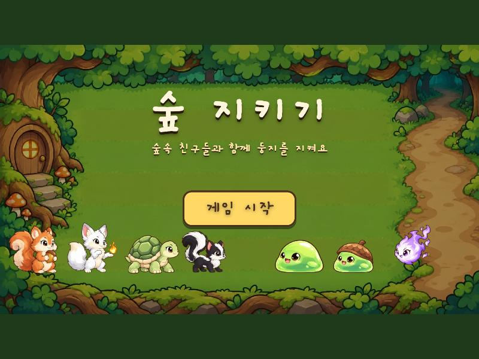
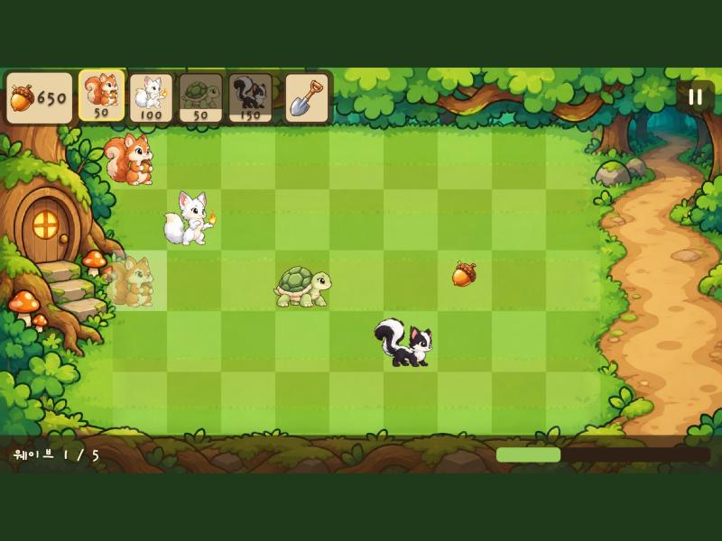
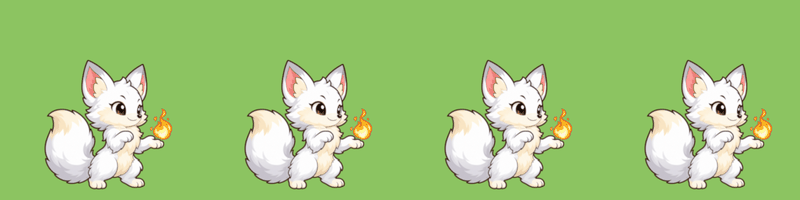

# 🌰 숲 지키기 (Forest Keepers)

숲속 동물들이 레인을 따라 몰려오는 귀여운 슬라임·정령으로부터 숲을 지키는 2D 레인 디펜스 게임이에요.
도토리를 모아 다람쥐·여우·거북이·까치 같은 숲 친구들을 칸에 배치하고, 몬스터가 왼쪽 둥지에 닿지 못하게 막아요. 둥지에는 하트가 셋 있어요.

> 📖 『작고 쓸모 있는 코딩 딴짓 — 코덱스와 시작하는 10분 바이브 코딩 프로젝트 29』(권경열, 한빛미디어) 저자가 만든 게임이에요.
> [예스24](https://www.yes24.com/product/goods/197774521) · [교보문고](https://product.kyobobook.co.kr/detail/S000221582195) · [알라딘](https://www.aladin.co.kr/shop/wproduct.aspx?ItemId=403862833)

> **개발 중** — 스테이지 10개·친구 8·적 7·레벨업·강화 상점까지 들어갔어요. 진행 상황은 [TODO.md](TODO.md)에서 볼 수 있어요.

| | |
|---|---|
| 엔진 | Flutter 3.44 + [Flame](https://flame-engine.org) 1.38 |
| 플랫폼 | Windows · 웹 · Android |
| 공개 예정 | PWA(GitHub Pages) · Microsoft Store |







## 바로 해 보기

**https://notard.github.io/forest-defense/** — 브라우저에서 바로 (PC·폰). 처음 연 뒤 한 번 더 열면(새로 고침 포함) 그다음부터는 인터넷 없이도 된다.
Chrome·Edge에서는 메인 화면 왼쪽 위 **앱으로 설치**로 홈 화면·바탕화면에 앱처럼 둘 수 있다.
main 브랜치에 푸시하면 GitHub Actions가 자동으로 다시 올린다 (`.github/workflows/pages.yml`).

## 실행하기

Flutter 3.44 이상이 필요해요.

```bash
flutter pub get
```

```bash
flutter run -d windows
```

```bash
flutter run -d chrome
```

```bash
flutter test
```

웹 빌드를 브라우저에서 보려면 (브라우저가 예전 파일을 저장해 두지 않고, 같은 포트에 서버가 이미 있으면 알려 줘요):

```bash
flutter clean && flutter build web --release && python tools/serve_web.py
```

→ http://localhost:8770 . 음악은 웹 정책상 첫 클릭("게임 시작") 뒤에 나와요.

GitHub Pages와 같은 하위 경로·오프라인 캐시로 확인하려면 (Git Bash에서는 경로가 바뀌지 않게 `MSYS_NO_PATHCONV=1`을 앞에):

```bash
flutter build web --release --base-href /forest-defense/ --no-web-resources-cdn && python tools/make_sw.py && python tools/serve_web.py 8790 --base /forest-defense/
```

확인용 주소 옵션 (웹 빌드):

- `?acorns=1000` 도토리 1000개로 시작
- `?practice=1` 레인마다 움직이지 않는 연습 상대 몬스터 (웨이브 없음)
- `?wave=5` 그 웨이브부터 시작
- `?speed=2` 게임 시계 배속 (1~4)
- `?intro=0` 카운트다운 없이 바로 시작
- `?stage=1-3` 메뉴 없이 그 스테이지 (모든 유닛). 옵션이 하나라도 있으면 메뉴 없이 바로 판
- `?enemy=golem,bat,mushroom,bossSlime` 연습 상대 종류 (`?practice=1`과 함께, 레인 순서대로)
- 둘 다: `?acorns=1000&practice=1`

## 조작

- 메인 화면에서 **게임 시작** → 숲 지도에서 스테이지를 골라요. 3 · 2 · 1 뒤에 시작해요.
- 스테이지를 깨면 별(★ 깸, ★★ 하트 안 잃음, ★★★ 동물 안 잃음)과 솔방울을 얻고 다음 스테이지·새 친구가 열려요. 진행은 저장돼요.
- 위쪽 카드를 누르고 잔디 칸을 누르면 동물을 놓아요. 같은 카드를 다시 누르면 취소예요.
- 다람쥐가 만든 도토리, 쓰러진 몬스터가 떨어뜨린 도토리, 둥지 문에서 굴러 나온 도토리를 눌러 모아요. 까치를 놓으면 근처 레인 도토리를 대신 물어 와요.
- 삽을 누르고 동물을 누르면 치워요 (도토리는 돌려받지 못해요).
- 몬스터가 둥지에 닿으면 하트가 하나 줄어요 (보스는 둘). 하트 셋을 다 잃으면 게임오버예요.
- 오른쪽 위 버튼으로 일시정지, 다시 하기를 할 수 있어요. 스피커 버튼으로 소리를 끄고 켜요.

## 폴더 구조

```
lib/
  main.dart                 앱 진입점 (GameWidget)
  game/
    forest_game.dart        게임 루트, 1280×720 고정 해상도 카메라
    config.dart             모든 수치 (칸 크기, 위치, 색, 폰트)
    strings.dart            화면에 나오는 모든 문구
    grid.dart               칸 ↔ 화면 좌표 변환
    components/             배경, 필드 입력, (예정) 유닛·몬스터·투사체
    hud/                    HUD (지금은 자리 표시)
test/                       좌표 변환·입력 경로·빠진 글자 테스트
assets/images/<캐릭터>/      동작별 스프라이트 시트(WebP) + <캐릭터>.json
assets/images/fx/           효과(도토리·연기·여우불·투구)와 배경
assets/audio/               효과음 WAV 12개
assets/fonts/               Gaegu Bold (게임에 쓰는 글자만 남긴 78 KB) + OFL.txt
tools/make_todo_html.py     TODO.md·WORKLOG.md → HTML
tools/subset_font.py        폰트에서 게임에 쓰는 글자만 남기기
tools/gen_art.py            Codex CLI로 캐릭터 기준 그림 그리기
tools/rigs/<캐릭터>.json     컷아웃 리그: 부위 자르는 선, 기준점, 동작 키프레임
tools/build_sprites.sh      기준 그림 → 부위 조각 → Blender 렌더 → 스프라이트 시트 → 미리보기
tools/prep_props.py         효과·배경 정지 그림 정리 (배경 잔디 줄무늬 지우기 포함)
tools/make_sfx.py           효과음 합성 (외부 음원 없음)
tools/serve_web.py          웹 빌드 개발 서버 (캐시 안 함, 포트 겹침 막기, --base 하위 경로)
tools/make_sw.py            웹 빌드에 오프라인 캐시 서비스 워커(sw.js) 만들기
tools/make_bgm.py           배경음악 4곡: 악보 → MIDI → 악기 소리로 녹음 → 반복용 MP3
art/ref/                    캐릭터 기준 그림
preview/                    단계별 캡처 (preview.html에서 모아 봄)
```

## 문서

| 문서 | 내용 |
|---|---|
| [plan.md](plan.md) | 개발 계획서: 레이아웃, 유닛·몬스터 수치, 단계별 완료 기준 |
| [TODO.md](TODO.md) | 체크리스트와 진행률 |
| [WORKLOG.md](WORKLOG.md) | 단계별 결과, 검증, 문제와 해결, 결정 이유 |
| [preview.html](preview.html) | 단계별 화면 캡처 |
| [art_preview.html](art_preview.html) | 스프라이트 시트를 실제 속도로 재생 |

## 문구를 바꿀 때

게임 폰트는 쓰는 글자만 남긴 파일이라, `lib/game/strings.dart`에 새 글자를 넣으면 폰트를 다시 만들어야 해요.
원본은 [google/fonts의 ofl/gaegu](https://github.com/google/fonts/tree/main/ofl/gaegu)에서 받아요. 다시 만들지 않으면 `flutter test`가 빠진 글자를 알려 줘요.

```bash
pip install fonttools
```

```bash
python tools/subset_font.py <원본 Gaegu-Bold.ttf 경로>
```

## 스프라이트 다시 만들기

캐릭터 기준 그림(`art/ref/`)과 리그(`tools/rigs/`)에서 스프라이트 시트를 다시 만들어요. [Blender](https://www.blender.org/) 5.2와 파이썬 `pillow`, `opencv-python`, `numpy`가 필요해요.

```bash
bash tools/build_sprites.sh fox
```

새 기준 그림은 [Codex CLI](https://github.com/openai/codex)(ChatGPT 계정 로그인)로 그려요.

```bash
python tools/gen_art.py ref fox
```

## 배경음악 다시 만들기

곡은 `tools/make_bgm.py` 안의 악보에서 만들어요. 아래 두 파일을 `tools/.cache/`에 받아 두고(저장소에는 넣지 않아요) [ffmpeg](https://ffmpeg.org/)가 있어야 해요.

- [FluidSynth 2.6.1](https://github.com/FluidSynth/fluidsynth/releases) Windows x64 압축 파일 → `tools/.cache/fluidsynth/`에 풀기
- [GeneralUser GS](https://github.com/mrbumpy409/GeneralUser-GS) `GeneralUser-GS.sf2` → `tools/.cache/`

```bash
python tools/make_bgm.py        # 4곡 모두
python tools/make_bgm.py boss   # 한 곡만
```

## 라이선스

- 폰트: [Gaegu](https://github.com/google/fonts/tree/main/ofl/gaegu) — Copyright 2018 The Gaegu Project Authors, SIL Open Font License 1.1 ([assets/fonts/OFL.txt](assets/fonts/OFL.txt))
- 배경음악: 이 저장소에서 직접 작곡. 악기 소리는 S. Christian Collins의 [GeneralUser GS](https://github.com/mrbumpy409/GeneralUser-GS) (음악 제작에 제한 없이 사용 가능), 녹음은 [FluidSynth](https://www.fluidsynth.org/) (LGPL, 만들 때만 쓰고 게임에는 들어가지 않음)
