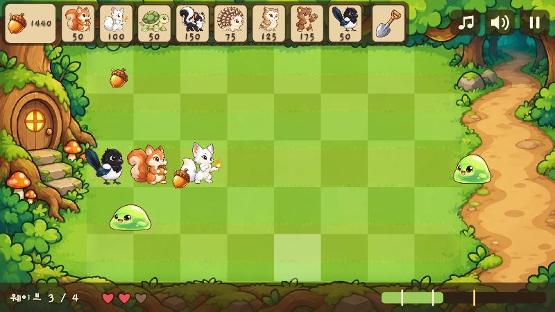
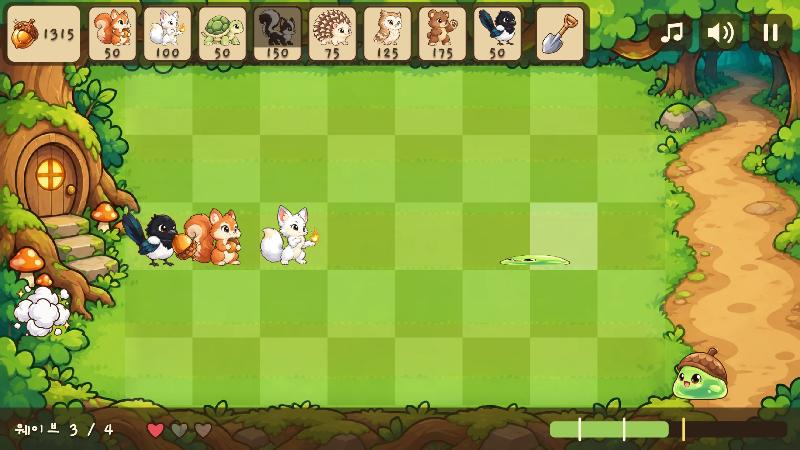

# 작업 기록 — 숲 지키기 디펜스

> 단계별 결과, 검증, 문제와 해결, 결정 이유를 기록한다. 체크리스트: [TODO.md](TODO.md) · 계획: [plan.md](plan.md)

## 0. 기획 (2026-10-13)

### 결정과 이유

| 항목 | 결정 | 이유 |
|---|---|---|
| 엔진 | Flutter + Flame | 사용자 제안. Flutter가 이미 설치돼 있고, Flame에 그리드 배치·충돌·스프라이트 기능이 있어 2D 레인 디펜스에 맞는다. 한 코드로 Windows·웹·Android를 낸다 |
| 그래픽 | 2D 카툰 스프라이트, Codex 생성 | 귀여운 카툰 느낌. 앱 아이콘 때 쓴 Codex CLI 흐름을 다시 쓴다 |
| 테마 | 동물 vs 귀여운 슬라임·정령 | 지난 프로젝트의 흰 여우를 이어 쓸 수 있고, 밝은 톤을 유지한다 |
| 자원 | 도토리 (떨어짐 + 다람쥐 생산, 클릭으로 줍기) | 14-1단계에서 몬스터·둥지 도토리 + 까치로 바꿈 |
| 유닛 | 다람쥐·여우·거북이·스컨크 4종 | 역할 네 가지를 모두 원했지만 후보가 6종이라 작은 데모 범위에 맞게 줄였다. 고슴도치·부엉이는 다음 단계 |
| 패배 규칙 | 레인별 통나무 1회 + 게임오버 | 한 번의 실수는 만회할 수 있다. 14-1단계에서 둥지 하트 3개로 바꿈 |
| 사운드 | 효과음만 | 데모 범위. 파이썬 합성으로 외부 음원 라이선스 문제를 피한다 |
| 진행 방식 | 여우 게임과 같게 (plan/TODO/WORKLOG, 단계별 미리보기) | 사용자 선택 |
| Git LFS | 쓰지 않음 | 스프라이트가 작은 PNG라 용량 부담이 없고, 웹 빌드를 GitHub Pages로 낼 때 LFS 파일은 서비스되지 않는다 |
| 공개 | PWA(GitHub Pages) + Microsoft Store (2026-10-13 추가) | 사용자 요청. Store에는 PWA를 포장하지 않고 네이티브 Windows 빌드를 MSIX로 낸다. 더 빠르고, 오프라인 실행과 효과음 재생이 브라우저 정책에 묶이지 않는다. PWA는 설치 없이 링크만으로 해볼 수 있는 통로로 둔다 |
| 경로 | `C:\forest_defense` | `C:\sample`은 여우 게임 저장소. Flutter 패키지 이름은 소문자와 밑줄만 쓸 수 있다 |

## 1. 프로젝트 생성 (2026-10-13)

### 결과 요약

| 항목 | 내용 |
|---|---|
| 프로젝트 | `C:\forest_defense`, `flutter create --platforms=windows,web,android --org com.notard` |
| 패키지 | flame 1.38.2, flame_audio 2.12.2, flame_test(개발용) |
| 게임 루트 | `lib/game/forest_game.dart` — `CameraComponent.withFixedResolution(1280, 720)`, 뷰파인더 앵커 왼쪽 위 |
| 수치 | `lib/game/config.dart`에 모음 |

### 검증
- `flutter analyze` 문제 없음, `flutter test` 1/1 통과 (카메라 해상도·앵커)
- `flutter build windows` → exe 실행 후 6초 동안 창이 유지됨
- `flutter build web` → 브라우저 패널(4:3)에서 16:9 필드와 위아래 레터박스 확인, 콘솔 에러 없음

### 문제와 해결
- 세션 폴더를 옮겨도 미리보기 서버는 `C:\sample\.claude\launch.json`을 읽었다. 그 파일은 git에서 제외된 로컬 파일이라 `forest-web`(8766, `build/web`)과 `forest-docs`(8767) 설정을 추가했다

## 1-1. Git 저장소 (2026-10-13)

- 사용자 승인 후 `gh repo create Notard/forest-defense --public`으로 만들고 `main`을 push했다 → https://github.com/Notard/forest-defense
- Public으로 한 이유: GitHub Pages(PWA 공개 예정)는 무료 계정에서 Public 저장소만 지원한다

## 2. 화면과 그리드 (2026-10-13)

### 결과 요약

| 파일 | 역할 |
|---|---|
| `lib/game/config.dart` | 칸 크기(100 × 110), 필드 위치(140, 110), 통나무 열, 등장 x, 색을 한곳에 모음 |
| `lib/game/grid.dart` | `Cell`(row, col) 레코드, `cellAt`(화면 → 칸), `topLeft`·`center`(칸 → 화면), `laneCenterY`, `allCells` |
| `lib/game/components/lane_background.dart` | 임시 배경: 둥지, 잔디 체크무늬, 등장 흙길, 레인 구분선 |
| `lib/game/components/field.dart` | 필드 입력: 마우스 올림 → 칸 밝게, 탭/클릭 → 노란 테두리 + `onCellTap` 콜백 |
| `lib/game/hud/hud_placeholder.dart` | HUD 슬롯 자리와 진행 바 자리, 슬롯 위치 상수 `HudLayout` |
| `preview.html`, `preview/02_*.jpg` | 세 화면 비율 캡처 |
| `README.md` | Flutter 템플릿 문구를 프로젝트 소개·실행 방법·구조·문서 목록으로 교체 |

### 진행 방식
- 좌표 변환은 Flame 컴포넌트와 분리된 순수 함수(`Grid`)로 만들어 단위 테스트를 먼저 붙였다. 4단계 배치, 6단계 몬스터 이동이 모두 이 함수를 쓴다
- 입력은 `TapCallbacks`(마우스 클릭과 터치 공통)와 `PointerMoveCallbacks`(마우스 올림)를 쓴다. 터치에는 올림이 없으므로 탭한 칸을 `selectedCell`로 남겨 눌린 칸이 보이게 했다
- 카메라가 고정이라 HUD를 따로 뷰포트 레이어에 두지 않고 월드에 우선순위(`priority`)로 겹쳤다. 화면 흔들림 같은 연출을 넣게 되면 그때 뷰포트로 옮긴다
- 진행 바를 오른쪽 아래로 옮겼다 (plan.md 2-1에 이유 기록)

### 검증
- `flutter analyze` 문제 없음
- `flutter test` **10/10** 통과
  - `grid_test.dart` 7개: 필드 모서리, 칸 경계가 오른쪽·아래 칸에 속하는지, 필드 밖 5곳(둥지·HUD·등장 구역·진행 바·음수), 칸 가운데 좌표, 레인 y, 45칸 전부 `center → cellAt` 왕복
  - `field_test.dart` 2개: 800 × 600 위젯 테스트 화면(4:3, 위아래 75px 레터박스)에서 실제로 탭해 칸 3곳이 맞게 선택되는지, HUD·둥지·등장 구역·레터박스를 탭하면 선택이 바뀌지 않는지
  - `forest_game_test.dart` 1개: 카메라 고정 해상도와 앵커
- 브라우저(웹 릴리스 빌드)에서 세 비율을 직접 확인, 콘솔 에러 없음

| 비율 | 창 크기 | 레터박스 | 확인 |
|---|---|---|---|
| 16:9 | 1280 × 720 | 없음 | (2, 4) 칸 올림 강조, (3, 6) 칸 클릭 선택 |
| 4:3 | 1024 × 768 | 위아래 | 창 크기를 바꾼 뒤에도 강조 위치 유지, (0, 8) 칸 클릭 선택 |
| 19.5:9 | 1560 × 720 | 양옆 | (4, 0) 칸 클릭 선택 |

### 발생한 문제와 해결
1. **테스트에서 `game.size`가 800 × 600이 아니라 1280 × 720이었다.** 고정 해상도 카메라를 쓰면 `FlameGame.size`가 가상 해상도를 돌려준다. 실제 화면 크기는 `canvasSize`로 확인하도록 고쳤다
2. **위젯 테스트가 "Pending timers"로 실패했다.** Flame의 탭 인식기(`MultiTapGestureRecognizer`)가 탭마다 40ms 타이머를 만든다. 탭 뒤에 `tester.pump(100ms)`로 시간을 흘려 해결했다
3. **브라우저 크기 흉내를 처음 켰을 때 화면이 2배로 확대돼 보였다.** 그 순간 기기 픽셀 비율이 1에서 2로 바뀌었는데 캔버스가 따라가지 않았다. 새로 고침하면 정상이었고, 그 뒤 일반적인 창 크기 변경(16:9 → 4:3 → 19.5:9)은 새로 고침 없이 정상이었다. 실제로는 배율이 다른 모니터로 창을 옮길 때 생길 수 있으므로 **9단계에서 다시 확인**한다
4. 브라우저 탭 제목이 로딩 중에 `forest_defense`로 보인다 (`web/index.html`의 `<title>`). 10단계에서 매니페스트를 정리할 때 함께 고친다

## 2-1. 한글 폰트: Gaegu Bold (2026-10-13)

### 왜 폰트를 넣는가
웹 빌드(CanvasKit)는 한글 글꼴이 없으면 Google 서버에서 Noto 폰트를 받아와 대신 쓴다. 오프라인 PWA에서는 그 요청이 실패해 한글이 깨지므로 폰트를 게임 안에 넣는다.

### 결정 경과

| 순서 | 내용 |
|---|---|
| 1 | 후보 3종을 실제 게임 문구로 비교하는 [font_preview.html](font_preview.html)을 만들었다 |
| 2 | 라이선스를 google/fonts 저장소의 OFL.txt 원문으로 확인: 셋 다 **SIL OFL 1.1**. 게임에 넣어 무료·유료 배포 가능, 조건은 라이선스 전문·저작권 표기 동봉과 폰트 단독 판매 금지 |
| 3 | 사용자가 Noto Sans KR을 골랐지만 원본이 **10.4 MB**라 Gaegu로 바꿨다 |
| 4 | Gaegu도 굵기당 약 3 MB라는 점을 알리고 방식을 다시 물었다 → **Bold 하나, 글자 줄이기**로 결정 |

### 결과 요약

| 항목 | 내용 |
|---|---|
| 원본 | `Gaegu-Bold.ttf` 2,893 KB, 글자 2,593개 (google/fonts `ofl/gaegu`). 저장소에는 넣지 않음 |
| 게임용 | `assets/fonts/Gaegu-Bold.ttf` **78 KB**, 글자 107개 + `assets/fonts/OFL.txt` |
| 남긴 글자 | `lib/` 문자열에 쓰인 한글·기호 + 영문·숫자·기본 기호 |
| 스크립트 | `python tools/subset_font.py <원본 경로> [--all-hangul]` |
| 문구 | `lib/game/strings.dart`에 모음. 지금은 `숲 지키기`, `웨이브 n / m` |
| 연결 | pubspec `fonts: Gaegu (weight 700)`, `GameConfig.fontFamily`, HUD 자리에 임시 글자(150, 웨이브 1 / 5) |

### 진행 방식
- 처음에는 자주 쓰는 한글 2,350자(KS X 1001)를 남기려 했다. 그런데 **Gaegu에는 원래 그 2,350자만 들어 있어서** 2,893 KB → 2,891 KB로 거의 줄지 않았다. 손글씨라 글자 하나의 윤곽 데이터가 크다(`glyf` 표가 파일의 99%)
- 그래서 게임에 실제로 쓰는 글자만 남기도록 바꿨다. 게임 문구는 정해져 있고 바뀌는 것은 숫자뿐이라 이 방식이 맞다. 2,350자가 다시 필요하면 `--all-hangul`을 쓴다
- 스크립트는 코드에 쓰인 글자가 원본 폰트에 없으면 멈춘다. 원본 Gaegu에는 `·`, `…`, `★`, `→` 같은 기호와 백틱(`)이 없어서 게임 문구에 쓰면 안 된다
- 원본 Gaegu에는 예약 폰트 이름(Reserved Font Name)이 없어 줄인 파일도 이름을 Gaegu로 둘 수 있다. 수정하면 무효가 되는 전자 서명 표(`DSIG`)만 뺐다

### 검증
- `flutter test` **13/13** 통과 (`font_coverage_test.dart` 3개 추가)
  - 영문·숫자(U+0020~007E, 백틱 제외)가 모두 있는지
  - `Strings`의 문구가 모두 있는지
  - `lib/` 아래 모든 `.dart` 문자열의 한글·기호가 폰트에 있는지. 폰트 파일의 `cmap` 표를 테스트가 직접 읽는다 (fonttools로 센 107자와 일치)
- 일부러 `title`을 `숲 지키기 다람쥐`로 바꾸자 두 테스트가 실패했고, 되돌린 뒤 통과했다
- 웹 빌드: `FontManifest.json`에 Gaegu 등록, 네트워크 요청은 로컬 `Gaegu-Bold.ttf` 하나뿐(Google 폰트 서버 요청 없음), 화면에 손글씨로 표시 → `preview/02-1_font.jpg`

### 발생한 문제와 해결
1. **2,350자 기준으로는 크기가 줄지 않았다** → 위 "진행 방식"대로 쓰는 글자만 남기는 방식으로 바꿨다
2. **스크립트 출력이 Windows 콘솔(cp949)에서 깨지고 `–` 같은 기호에서 멈췄다** → `sys.stdout.reconfigure(encoding="utf-8")`
3. **파이썬 3.11에서는 f-string 안에 같은 종류의 따옴표를 쓸 수 없어** 문법 오류가 났다 → 변수로 빼서 해결
4. **`dart:ui`와 `flutter/painting.dart`의 `TextStyle` 이름이 겹쳤다** → HUD 파일은 `flutter/painting.dart`만 쓰도록 정리
5. **테스트의 정규식을 raw 삼중 따옴표로 쓰다가 문자열이 닫히지 않았다** → 두 raw 문자열을 이어 붙이는 방식으로 바꿨다

## 3. 아트와 애니메이션 — 계획 변경 (2026-10-13)

### 무엇이 바뀌었나
사용자가 "애니메이션 연출은 [Spriteflow](https://spriteflow.io/)를 참고해서 만들어야 한다"고 했다. 처음 계획(그림 한 장 + 코드로 흔들기)을 **동작별 프레임 애니메이션(스프라이트 시트)**으로 바꿨다. 자세한 사양은 plan.md 3단계에 있다.

### Spriteflow 조사 (2026-10-13, 공식 사이트·가격·약관 페이지)

| 항목 | 내용 |
|---|---|
| 무엇인가 | AI 스프라이트 생성기. 캐릭터 그림 1장 + 동작 설명 → 같은 그림체의 동작 프레임 → 스프라이트 시트. 뼈대(스켈레탈) 방식이 아님 |
| 동작 프리셋 | idle · walk · run · jump · 근접/원거리 공격 · 마법 · 피격 · 쓰러짐 · 승리 등 |
| 사양 | 동작당 6~12프레임(걷기 6~8), 픽셀아트 8fps / 매끈한 2D 12~24fps, 16~512px, PNG 시트 + JSON |
| 가격 | 연간 결제 기준 월 $19.90(2,400크레딧)부터, 매일 무료 크레딧 |
| 약관 | 유료 플랜에서 공식 Download로 받은 결과물만 상업적 사용 가능. **무료·프로모션 크레딧 결과물은 비상업적 평가용만.** 생성물은 기본적으로 서비스 학습·홍보에 쓰일 수 있음(설정에서 끄기) |

### 결정과 이유

| 항목 | 결정 | 이유 |
|---|---|---|
| 서비스 사용 | 쓰지 않고 **연출 방식만 참고** (사용자 선택) | Store 출시에는 유료 플랜이 필요하다. 대신 "기준 그림 + 동작 설명" 흐름을 Codex(`codex exec -i 기준그림`)로 따라 한다 |
| 동작 범위 | 피격·쓰러짐까지 전부 (사용자 선택) | 시트 25장 + 효과 5장 |
| 프레임·속도 | 6~10프레임, 12fps (쓰러짐 10fps) | Spriteflow가 권하는 매끈한 2D 범위의 아래쪽. 장수를 줄여 Codex 생성 횟수와 어긋남 위험을 줄인다 |
| 투구 슬라임 | 파랑 → 초록 슬라임 + 도토리 깍지 투구 | 투구가 깨지면 일반 슬라임 시트로 바꾸므로 몸이 같아야 자연스럽다 |
| 진행 순서 | 여우 하나로 시범 → 승인 → 나머지 | Codex가 프레임마다 모양을 다르게 그릴 위험이 있어 먼저 확인한다. 안 되면 컷아웃(부위별 코드 움직임)으로 바꾼다 |

### 3-a. 여우 기준 그림 (2026-10-13)

| 항목 | 내용 |
|---|---|
| 도구 | `tools/art_prompts.json`(공통 스타일·배경·캐릭터 7종 설명·여우 동작 4개), `tools/gen_art.py`(`ref`/`action` 하위 명령) |
| 결과 | `art/ref/fox.png` 1254 × 1254, 투명 배경. 흰 털·크림색 가슴·분홍 귀 안쪽·연회색 귀 끝·갈색 외곽선, 오른쪽을 보고 앞발 위에 여우불 |
| 게임 크기 확인 | 잔디 칸(100 × 110) 위에 높이 90·100·108·116px로 놓아 봄 → `preview/03_fox_ref_ingame.png`. **96~100px**가 알맞다 (그보다 크면 꼬리·여우불이 칸 가장자리에 닿음) |
| 소요 시간 | 생성 1회 약 1분 20초 |

**발생한 문제와 해결**
1. **Codex 기본 모델(`gpt-6.1-sol`)이 ChatGPT 계정 로그인에서 지원되지 않아** 바로 실패했다. 사용자 설정(`~/.codex/config.toml`)은 건드리지 않고, 지난 아이콘 작업에서 쓴 `gpt-5.6-sol`을 `gen_art.py`에서 `-m`으로 지정했다 (환경 변수 `CODEX_MODEL`로 바꿀 수 있음)
2. **첫 결과가 사실적인 붉은 여우였다** (`art/rejected/`에 보관, git 제외). 로그를 보니 Codex가 "art brief가 없다"며 파일 이름만 보고 그렸다. Windows의 `codex`는 `.cmd` 배치 파일이라 **여러 줄 인자가 첫 줄에서 잘린다.** 프롬프트를 표준 입력(`codex exec ... -`)으로 넘기도록 고치자 브리프 전체가 전달됐다
3. 투명 배경은 실제 알파로 나왔지만 두 가지가 지저분했다: 몸통이 불투명 100%가 아니라 **94~99%**(잔디 위에서 살짝 비침), 눈에 안 보이는 **알파 1~15 점 1만 7천 개**가 퍼져 있어 경계 상자가 그림 전체였다. `prep_sprites.py`에서 알파 16 미만 → 0, 200 이상 → 255로 정리하기로 했다 (위 확인 그림은 이 정리를 적용한 것)

### 3-b. 방식 변경: Blender 2D 컷아웃 + 여우 시범 (2026-10-13)

**왜 바꿨나.** 기준 그림을 보여드리자 사용자가 "블렌더로 애니메이션을 만들어 2D로 텍스처를 입히면 어색할까" 물었다. 두 가지를 비교해 알렸다.

| | Codex 프레임 생성 (원래) | **A. 2D 컷아웃** (선택) | B. 3D 툰 렌더 |
|---|---|---|---|
| 프레임끼리 일관성 | 위험 | 완벽 (같은 조각) | 완벽 |
| 그림체 | Codex 일러스트 | Codex 일러스트 그대로 | 3D 느낌으로 바뀜 |
| 2D 게임에서 흔한 방식인지 | 보통 | 흔함 (컷아웃) | 드묾 |
| 준비 | 동작마다 생성 | 캐릭터마다 리그 1번 | 털 많은 캐릭터 모델링이 어려움 |

사용자가 A를 골랐다. 결과물(동작별 시트 + JSON)은 같아서 게임 쪽 계획은 바뀌지 않는다.

**결과 요약**

| 항목 | 내용 |
|---|---|
| 부위 | 꼬리 → 뻗은 앞발 → 몸통(접은 앞발·뒷발 포함) → 머리 → 여우불 (뒤에서 앞 순서). 뻗은 앞발은 가슴 털 **뒤**에 있다 |
| 계층 | 몸통(발 기준) → 머리·앞발·꼬리, 앞발 → 여우불 |
| 시트 | `assets/images/fox/`: idle 12장(452 KB) · attack 8장(414 KB) · hit 4장(186 KB) · death 8장(394 KB), 한 칸 320 × 320 |
| 메타데이터 | `fox.json`: anchor(발) [186.9, 303.2], muzzle(여우불) [259.4, 212.2], 공격 이벤트 5번째 |
| 동작 | 기본: 숨쉬기(몸 늘었다 줄기)·고개·꼬리·불꽃 일렁임 / 공격: 1~3 움츠리며 불 키우기 → 5 던지기(불 사라짐) → 7~8 새 불 / 피격: 뒤로 밀리며 찌그러짐 / 쓰러짐: 어지럽게 흔들리다 납작하게 주저앉기 |
| 속도 | 자르기~미리보기 전체 약 10초 (`bash tools/build_sprites.sh fox`) |
| 미리보기 | [art_preview.html](art_preview.html) (실제 속도·¼ 느리게·한 프레임·게임 크기), GIF `preview/03_fox_*.gif` |

**검증**
- 자르기: 주인 없는 픽셀 0, 조각을 다시 합친 그림이 기준 그림과 다른 불투명 픽셀 0
- 렌더 1프레임(쉬는 자세)을 기준 그림을 같은 크기로 줄인 것과 비교: 평균 색 차이 6.9/255 (줄이기 차이 수준)
- 모든 프레임을 한 장에 모아 틈·삐져나옴을 눈으로 확인, 게임 크기(키 100px)에서 잔디 칸 위 확인

**발생한 문제와 해결**
1. **경계를 눈대중 다각형으로 자르니 머리 볼 털 일부가 꼬리 조각으로 갔다** → 다각형을 픽셀 단위로 맞추는 대신, 떨어져 나온 작은 섬(부위의 2% 미만)을 가장 많이 맞닿은 부위에 넘기는 정리 단계를 넣었다 (2,123픽셀 이동)
2. **불꽃 가운데(253,253,222)가 앞발 크림색(253,247,232)과 거의 같아** 색으로 못 나눴다 (211픽셀이 주인 없음) → 채도 높은 주황 테두리를 찾고 그 안쪽을 채우는 방식으로 바꿨다
3. **렌더에서 꼬리의 가려진 채움이 몸통 위로 비쳤다** → EEVEE 반투명(BLENDED) 물체는 원점 거리로 그리는 순서를 정하는데 모든 평면의 원점이 같은 곳이었다. 평면마다 원점을 자기 가운데·자기 깊이에 두어 해결
4. **채움을 앞 부위 모양대로 하니 부위가 돌 때 테두리 없는 흰 띠가 바깥으로 삐져나왔다** → 실루엣을 닫는(closing) 방식은 채움이 거의 없어져(23~74픽셀) 고개를 들면 틈이 생길 상황이라 버리고, **전체 실루엣 바깥 테두리에서 30px 안쪽만** 채우도록 했다
5. **쓰러짐에서 몸을 발 기준으로 크게 눕히니 꼬리·등이 바닥 아래로 파고들어 캔버스에서 잘렸다** → 쓰러짐을 "어지럽게 흔들리다 납작하게 주저앉기"로 바꾸고 회전은 작게, 캔버스 아래 여유를 90px 늘렸다
6. 남은 작은 흠: 던진 뒤 앞발 끝에 불꽃 가장자리 점 몇 개, 쓰러짐 마지막에 꼬리 쪽 작은 흰 조각. 게임 크기에서는 안 보이고, 쓰러짐은 게임에서 연기 효과로 덮는다

### 3-c. 나머지 기준 그림 + 다람쥐 (2026-10-13)

**기준 그림 6종** (`art/ref/`, 한 장에 약 1분 반)
- 여우 그림을 **그림체 참고**로 함께 넣고 "새 캐릭터를 그리되 외곽선·셀 셰이딩·색감은 이 그림과 같게"라고 했다. 여섯 장 모두 여우와 같은 그림체로 나왔다 → `preview/03_refs_lineup.jpg`
- 투구 슬라임은 `based_on: slime`으로 **슬라임 그림을 넣고 투구만 씌우게** 했다. 몸 모양·표정이 그대로라 투구가 깨지면 슬라임 시트로 바꿔도 자연스럽다
- 컷아웃으로 자르기 쉽게 자세를 프롬프트에 적었다 (꼬리·다리·머리가 몸통과 많이 겹치지 않게). 슬라임은 거의 정면이지만 덩어리 모양이라 방향 문제는 없다
- `tools/rig_helper.py`: 리그 좌표를 읽는 격자 그림 (전체 / 영역 확대)

**다람쥐** (`tools/rigs/squirrel.json`)

| 항목 | 내용 |
|---|---|
| 부위 | 꼬리 → 몸통 → 머리 → hug(도토리를 안은 두 앞발 + 도토리) |
| 동작 | 기본 12 · 도토리 만들기 8 (도토리를 들어 흔들다 5번째에 꽉 쥐면 게임이 도토리를 만든다) · 피격 4 · 쓰러짐 8 |
| 이벤트 위치 | `muzzle_part: hug` → 만든 도토리가 튀어나오는 곳. `pack_sheets.py`가 부위를 고를 수 있게 일반화 |

**발생한 문제와 해결**
1. **꼬리와 머리 사이에 크림색 띠가 보였다.** 채움 색이 "부위의 가장 밝은 털"이라 흰 여우에는 맞았지만 주황 꼬리에서는 크림색 배 쪽 색이 골라졌다 → **가려진 곳 바로 옆의 털 색**(외곽선 뺀 중앙값)으로 바꿨다
2. **피격 때 앞발이 내려가면 턱과 도토리 사이에 틈이 생겼다** → 머리에도 `fill_band`를 줘서 도토리 뒤 턱 부분을 채웠다. 몸통 영역도 볼 아래까지 넓혔다
3. 볼 아래 왼쪽의 작은 초록 틈은 원본 그림에도 있는 배경(꼬리·볼·몸통 사이)이라 그대로 둔다

### 3-d. 거북이 (2026-10-13)

| 항목 | 내용 |
|---|---|
| 부위 | 몸통(등껍질·다리·꼬리) → 머리. 목에는 외곽선이 없어 y≈760에서 자르고, 기준점을 그 자리에 두어 머리가 돌아도 이음매가 거의 움직이지 않게 했다 |
| 동작 | 기본 12 · **금 간 기본 12** (HP 50% 이하, 고개를 살짝 떨굼) · 피격 4 (머리를 움츠림) · 쓰러짐 8 (머리를 등껍질 쪽으로 넣고 납작해짐) |
| 새 기능 | 리그 `variants`: 부위 조각 위에 선을 그려 바꿔 끼울 그림을 만든다 (`body_cracked`). 동작 `textures`: 그 동작에서만 부위 그림을 바꾼다 (`blender_cutout.py`) |
| 크기 | 거북이는 키보다 폭이 넓다 (1220 × 865). 게임에서는 키가 아니라 폭을 칸에 맞춰야 한다 → 4·5단계에서 캐릭터별 표시 크기를 둔다 |

**발생한 문제와 해결**
1. 처음 그린 금(굵기 11px, 4줄)은 게임 크기에서 보이지 않았다 → 굵기 20px, 6줄로 늘렸다. 금마다 아래쪽에 옅은 흰 결을 함께 그려 틈처럼 보이게 했다

### 3-e. 스컨크 (2026-10-13)

| 항목 | 내용 |
|---|---|
| 부위 | 꼬리 → 몸통(다리·가슴·등 줄무늬) → 머리 |
| 동작 | 준비 12장 10fps = **1.2초** (점점 부풀며 점점 빠르게 떨기, 꼬리 흔들기) · 폭발 8장 (찌그러졌다 늘어나 3번째에 1.4배로 터짐 = 피해 판정, 이후 작아져 사라짐) |
| 이벤트 위치 | 폭발 중심은 발이 아니라 몸 가운데여야 해서 리그에 `muzzle_point`(좌표 직접 지정)를 추가 |
| 게임 쪽 | 폭발 4번째 프레임부터는 게임의 쓰러짐 연기 효과가 덮는다 |

### 3-f. 몬스터 3종 (2026-10-13)

| 몬스터 | 부위 | 동작 |
|---|---|---|
| 슬라임 | 몸 하나 (한 덩어리라 늘었다 줄기만으로 충분) | 이동 12 (움츠렸다 통통 뛰고 착지에 찌그러짐) · 갉아먹기 6 (앞으로 숙여 3번째에 깨묾 = 피해) · 피격 4 · 쓰러짐 8 (녹아 퍼짐) |
| 투구 슬라임 | 몸 → 투구 | 이동 · 갉아먹기 · 피격 (투구가 몸보다 한 박자 늦게 흔들림, 맞으면 투구가 '땡' 튐). 쓰러짐은 없고 투구가 깨지면 슬라임 시트로 바뀐다 |
| 도깨비불 | 몸 → 불꽃 꼬리 | 떠다니기 12 · 갉아먹기 6 (앞으로 돌진) · 피격 4 · 쓰러짐 8 (일렁이며 작아져 사라짐) |

- 몬스터는 왼쪽을 보므로 "앞으로 숙이기"는 rot −, "앞으로"는 dx −다
- **투구가 깨질 때 시트가 튀지 않게** 투구 슬라임 캔버스를 슬라임 몸 폭 비율(950/1200 = 0.79)로 맞췄다. 두 시트의 발 위치가 [161.0, 287.4]와 [159.9, 287.9]로 1px 안에서 같다. 뛰는 높이도 같은 비율로 줄였다
- 이동은 게임이 하고 시트는 제자리에서 움직인다

**발생한 문제와 해결**
1. 슬라임 쓰러짐에서 1.6배로 퍼지니 프레임 밖으로 잘렸다 → 1.3배로 줄였다
2. 도깨비불 쓰러짐을 발(아래 끝) 기준으로 빙글 돌리니 원을 그리며 프레임 밖으로 나갔다 → 회전 대신 일렁이며 작아져 위로 사라지게 바꿨다

### 3-g. 효과·배경, 필드를 배경에 맞춤 (2026-10-13)

**효과** (`assets/images/fx/`, `tools/prep_props.py`)

| 효과 | 그림 | 크기 |
|---|---|---|
| 도토리 | Codex (`gen_art.py prop acorn`) | 96 × 96 |
| 통나무 | Codex, 나이테 단면 (돌리면 굴러가는 것처럼 보이게) | 128 × 128 |
| 연기 | Codex | 192 × 160 |
| 여우불 | 여우 컷아웃의 불꽃 조각 | 96 × 128 |
| 투구 | 투구 슬라임 컷아웃의 투구 조각 | 160 × 140 |

효과는 프레임 대신 정지 그림을 게임 코드가 돌리고·키우고·흐리게 한다 (plan.md 3-5). 카드도 그림 없이 코드로 그린다.

**배경** (`background.jpg`, 1672 × 940, 241 KB): 왼쪽 나무뿌리 굴 문과 버섯, 위 나무 지붕, 오른쪽 몬스터가 나오는 흙길, 아래 이끼 뿌리 띠. 프롬프트에 화면 비율로 구역을 정해 줬고 그대로 나왔다. 고해상도 화면을 위해 1280 × 720으로 줄이지 않고 원본 해상도로 저장했다.

**필드를 배경에 맞춤**

| | 전 | 후 |
|---|---|---|
| 칸 | 100 × 110 | **96 × 108** |
| 필드 | x 140~1040, y 110~660 | **x 200~1064, y 108~648** (잔디밭 x 207~1055, y 110~646) |
| 통나무 열 · 등장 x | 60~140 · 1100 | 120~200 · 1120 |

- 그림을 늘리면 일그러지므로 칸을 그림에 맞췄다. `grid_test.dart`는 숫자 대신 `GameConfig` 기준으로 다시 쓰고, "필드가 배경 잔디밭과 거의 겹친다" 검사를 추가했다 (배경을 바꾸면 다시 잰다)
- 게임 배경(`LaneBackground`)을 색 면에서 **그림 + 옅은 칸 체크무늬**로 바꿨다. 웹 빌드에서 확인
- 모든 캐릭터·효과를 칸에 세워 본 확인 그림: `preview/03_mockup.jpg`

**검증**: `flutter analyze` 문제 없음, `flutter test` **14/14**, 웹 빌드 콘솔 에러 없음

**발생한 문제와 해결**
1. **Codex가 효과 그림을 스스로 96px 등으로 줄여 저장했다.** 프롬프트에 "최종 크기는 96 × 96"이라고 쓴 탓이다. 이번 그림은 쓸 만해서 그대로 쓰고, 앞으로는 "원본 해상도로 저장, 줄이지 말 것"이라고 쓰고 줄이기는 `prep_props.py`가 하게 고쳤다
2. **배경 잔디에 줄무늬가 7개(약 87px 간격)라 레인 5개(108px)와 맞지 않았다.** `prep_props.py`의 `flatten_rows`가 잔디 영역의 가로줄 밝기를 평균에 맞춰 줄무늬를 지운다 (풀결은 남김, 가장자리 30px는 원래 그림과 섞음). 줄 밝기 차이가 131~144에서 135~137로 줄었다. 레인 구분은 게임이 그리는 체크무늬가 맡는다
3. **배경 그림을 에셋에서 읽게 되자 테스트 3개가 실패했다.** 위젯 테스트의 가짜 시계에서는 그림 해독이 끝나지 않아 필드가 붙기 전에 탭했고, 위젯 없이 띄운 카메라 테스트에는 에셋 번들이 없었다. 탭 테스트는 실제 시간으로 필드가 붙을 때까지 기다리고, 카메라 테스트는 `GameTester.testGameWidget`로 바꿨다
4. 확인 그림에서 본 것 (5단계에서 조정): 통나무가 첫 칸 다람쥐 꼬리와 겹친다, 키 74px의 거북이에서는 금이 다시 흐리다

### 3단계 마무리 (2026-10-13)
- 사용자가 확인 그림과 `art_preview.html`을 보고 승인했다 ("좋아 합격")
- 결과: 캐릭터 7종 시트 25장(여우 4 · 다람쥐 4 · 거북이 4 · 스컨크 2 · 슬라임 4 · 투구 슬라임 3 · 도깨비불 4), 효과 5종, 배경 1장
- 5단계로 넘긴 것: 통나무와 첫 칸 다람쥐 꼬리 겹침, 게임 크기에서 거북이 금 굵기

## 4. 자원과 유닛 배치 (2026-10-13)

### 결과 요약

| 파일 | 역할 |
|---|---|
| `lib/game/units.dart` | 유닛 4종 수치 (비용·쿨다운·HP·표시 키). 스컨크는 놓자마자 `arm`(준비) 동작 |
| `lib/game/garden.dart` | 규칙: 도토리(시작 150, 하나 25), 카드 쿨다운, 칸 점유, 삽(환불 없음). 화면과 분리 |
| `lib/game/art.dart` | `CharacterArt`: `<캐릭터>.json` + 시트를 Flame 애니메이션으로, 캐릭터별 캐시. 키 기준 배율 (`bbox` 사용) |
| `lib/game/components/unit.dart` | 칸에 선 유닛. 발을 칸 아래 끝에서 8px 위에, 아래 레인일수록 앞에 그림 |
| `lib/game/components/acorn.dart` | 줍는 도토리 + 하늘 도토리 생성기 (7~10초, 첫 4초) |
| `lib/game/components/ghost.dart` | 카드를 고른 채 마우스를 올린 칸에 놓일 모습 (반투명) |
| `lib/game/hud/hud.dart`, `layout.dart` | HUD: 반투명 판, 도토리 수, 카드 4장, 삽, 일시정지 자리, 웨이브·진행 바 자리 |
| `lib/game/forest_game.dart` | 고른 카드·삽 모드, 칸 누르기 처리, `?acorns=` 시작 도토리 |
| `assets/images/fx/shovel.png` | 삽 아이콘 (Codex). 이번에는 원본 해상도(636 KB)로 받았다 |

### 진행 방식
- 규칙(`Garden`)을 먼저 순수 Dart로 만들고 단위 테스트 8개를 붙인 뒤 화면을 얹었다
- 실제 입력 경로 테스트(`placement_test.dart`) 5개: 카드 → 칸 놓기, 찬 칸 거절과 취소, 삽, 도토리 부족 카드, 도토리 줍기 (한 프레임씩 시간을 흘려 확인)
- 테스트 공통 도구를 `test/support.dart`로 모았다 (화면 좌표 변환, 로드 대기, 탭)
- 웹 빌드를 브라우저에서 직접 플레이했다: 다람쥐·여우 놓기 → 도토리 줍기(0 → 25) → 삽으로 다람쥐 치우기(도토리 그대로 25), 그리고 `?acorns=1000`으로 네 유닛을 모두 놓고 쿨다운이 따로 도는지 확인 → `preview/04_place.jpg`

### 검증
- `flutter analyze` 문제 없음, `flutter test` **27/27** (규칙 8 · 입력 경로 5 · 필드 2 · 그리드 8 · 폰트 3 · 카메라 1)
- 웹: 콘솔 에러 없음. 8초 뒤 다람쥐·여우 카드는 다시 눌리고 거북이(30초)·스컨크(50초)는 덮개가 남아 있음

### 발생한 문제와 해결
1. **HUD가 테스트에서 끝내 붙지 않았다.** 놓기 미리보기를 `SpriteComponent`로 만들었는데, 이 컴포넌트는 붙는 순간 그림이 꼭 있어야 한다(assert). 평소에 그림이 없는 미리보기가 assert에 걸리자 그 뒤에 붙을 HUD까지 멈췄다 → 미리보기를 `PositionComponent`로 바꾸고 그림이 있을 때만 직접 그린다
2. **브라우저에서 도토리를 눌렀는데 수가 안 늘었다.** 테스트로 한 프레임씩 재현해도 정상이었다. 원인은 내 조작이 느린 것: 화면을 찍고 다음 클릭까지 몇 초씩 걸려 도토리가 8초 수명이 끝나 이미 사라진 뒤였다. 바로 누르자 0 → 25로 정상
3. **도토리 수가 세 자리가 되자 숫자가 아이콘을 덮었다** ("650"의 6) → 아이콘 옆 58px에 들어가도록 글자 크기를 40 → 24까지 줄여 맞춘다
4. 브라우저 패널이 1280 × 720 흉내보다 작을 때 화면이 잘려 보였다 → 확인은 패널 원래 크기(1024 × 768, 위아래 레터박스)에서 했다. 좌표 변환은 테스트와 같다
5. 나중에 할 것 (7단계): 삽 모드일 때 칸 강조 색을 바꾸기, 터치에서도 놓일 모습 보이기

## 5. 유닛 능력 (2026-10-13)

### 진행 방식
- 여우 공격과 스컨크 폭발을 확인하려면 맞힐 몬스터가 필요한데, 몬스터는 6단계다. 그래서 **몬스터 바탕(`Monster`)을 먼저 만들되 제자리에 세운 연습 상대**로만 쓰고(`?practice=1`), 이동·갉아먹기·웨이브는 6단계로 남겼다
- 유닛과 몬스터가 같이 쓰는 `Actor`를 만들었다: 시트 전환, 이벤트 프레임(시트 JSON의 `event`), HP, 맞을 때 흰색 깜빡임(색 필터), 피격 동작, 쓰러짐 동작 → 연기
- 유닛은 동물별 하위 클래스(`Squirrel`, `Fox`, `Turtle`, `Skunk`)로 나눴다

### 결과 요약

| 동물 | 동작 |
|---|---|
| 다람쥐 | 놓고 7초 뒤, 이후 24초마다 `produce`. 5번째 프레임에 도토리가 위로 튀었다 포물선으로 오른쪽 34~64px에 떨어진다 (중력 1400) |
| 여우 | 같은 레인, 자기보다 오른쪽, 화면 안에 살아 있는 몬스터가 있으면 1.5초마다 `attack`. 5번째 프레임에 불꽃 위치에서 여우불 발사 (420 px/초, 피해 20, 처음 닿는 몬스터 하나) |
| 거북이 | HP 4000. 2000 아래로 떨어지면 `idle_cracked` |
| 스컨크 | 놓자마자 `arm`(1.2초) → `explode` 3번째 프레임에 큰 연기 + 주변 3 × 3칸(레인 ±1, 가로 ±1.5칸) 몬스터에게 1800 → 칸 비움 |
| 투구 슬라임 | 투구 HP 370이 먼저 깎이고, 0이 되면 투구가 돌며 날아가고 슬라임 시트로 바뀐다 |

효과: `Smoke`(커지며 흐려짐), `FlyingHelmet`(포물선 + 회전), `Fireball`(눕혀서 일렁임). 효과 그림은 게임 시작 때 미리 읽는다.

### 검증
- `flutter analyze` 문제 없음, `flutter test` **32/32** (`abilities_test.dart` 5개 추가)
  - 여우: 다른 레인·뒤쪽 몬스터에는 안 쏨, 앞 몬스터가 생기면 0.5초 안에 발사, 가까운 몬스터만 20 피해
  - 다람쥐: 6.9초까지 도토리 0개, 7.5초에 1개, 1.5초 뒤 오른쪽에 내려앉음
  - 스컨크: 옆·대각선 몬스터만 쓰러지고 두 레인 아래·세 칸 오른쪽은 남음, 칸이 빔
  - 거북이: 1900 피해에는 그대로, 2100에서 금 간 등껍질, 0에서 칸이 빔
  - 투구 슬라임: 300 피해는 투구가 받음, 400에서 투구가 깨지며 몸에 30, 슬라임 그림으로 바뀌고 투구가 날아감
- 웹(`?acorns=1000&practice=1`)에서 직접 확인 → `preview/05_*`
  - 스컨크 폭발 순간 세 레인 몬스터가 흰색으로 깜빡이고 다음 화면에서 연기가 됨
  - 위 레인 여우가 약 15초(10발) 뒤 슬라임을 쓰러뜨리고, 레인이 비자 쏘기를 멈춤
  - 다람쥐 도토리가 7초에 튀어나옴

### 발생한 문제와 해결
1. **테스트에서 여우불이 생기지 않았다.** 여우불은 붙을 때 그림을 비동기로 읽는데, 테스트의 동기 프레임 반복에서는 그 읽기가 끝날 틈이 없었다. 실제 게임에서도 첫 발에 한 박자 늦을 수 있는 문제라 **효과 그림을 게임 시작 때 미리 읽게** 했고, 테스트는 프레임 사이에 실제 시간을 조금씩 흘린다
2. 미리 읽기를 넣으면서 필드·HUD를 만들기 전에 기다리게 되어 테스트 도구가 아직 없는 `field`를 읽었다(`LateInitializationError`) → 컴포넌트를 먼저 만들고 그다음 읽게 바꾸고, 테스트 도구는 게임 로드가 끝났는지 먼저 본다
3. 다람쥐 도토리가 다람쥐 발 위에 반쯤 겹쳐 떨어졌다 → 18~48px에서 34~64px 오른쪽으로 옮겼다
4. 브라우저 패널 배율이 바뀐 뒤 화면이 확대돼 보이는 현상이 다시 있었다 (2단계 문제 3과 같음, 새로 고침하면 정상). 9단계 확인 항목에 이미 있다
5. **그림 용량이 크다**: 스프라이트 PNG 31장이 10.7 MB라 웹에서 연습 모드 첫 화면까지 몇 초 걸렸다. WebP(품질 88)로 바꾸면 2.2 MB로 줄어든다 → 9단계 TODO에 추가 (화질 확인 후)

## 6-0. 그림을 WebP로 (2026-10-13)

사용자 요청으로 9단계에 있던 그림 용량 줄이기를 6단계 전에 앞당겨 했다.

| | 전 (PNG/JPG) | 후 (WebP) |
|---|---|---|
| `assets/images` 전체 | 11 MB | **2.4 MB** |
| 스프라이트 시트 31장 | 10.7 MB | 품질 88 |
| 효과 | PNG | 품질 90 |
| 배경 | JPG 241 KB | 품질 85, 129 KB |
| 웹 연습 모드 첫 화면 | 약 7초 | 약 3초 (그림 19장, 1.27 MB 내려받음) |

- **화질 확인**: 여우·다람쥐·도깨비불 시트를 PNG와 비교 → 투명도 차이 0 (WebP 손실 압축에서도 알파는 무손실), 색 차이 평균 2.5~3.3/255. 2배 확대해 나란히 봐도 구분되지 않았다
- 바꾼 곳: `pack_sheets.py`(시트 WebP, 예전 PNG 지움), `prep_props.py`(효과·배경), `make_art_preview.py`·`make_gifs.py`, 게임 코드의 그림 경로 9개 파일
- 검증: `flutter test` 32/32 (테스트가 실제 WebP를 읽는다), 웹 빌드 콘솔 에러 없음·PNG 요청 0개, Windows exe 빌드 후 실행 유지 (화면은 직접 보지 못해 9단계 사용자 확인 항목으로 남김)

## 6. 몬스터와 웨이브 (2026-10-13)

### 결과 요약

| 파일 | 역할 |
|---|---|
| `lib/game/waves.dart` | 웨이브 5개 정의 + `WaveDirector`(규칙, 화면과 분리): 몬스터 내보내기, 다음 웨이브 시점, 큰 무리 경고, 진행 바 비율, 시작 웨이브 지정 |
| `lib/game/components/wave_runner.dart` | 규칙을 게임에 연결 (몬스터 생성, 웨이브 글자) + 가운데 큰 글자 `Banner` |
| `lib/game/components/monster.dart` | 이동(칸당 4.7초 / 도깨비불 2.3초), 갉아먹기, 둥지 앞 도착 |
| `lib/game/components/actor.dart` | `canFlinch`: 갉아먹는 몬스터는 맞아도 피격 동작 없이 깜빡이기만 |
| `lib/game/hud/hud.dart` | 웨이브 번호, 진행 바 + 웨이브 표시 |
| `lib/main.dart` | 확인용 `?wave=5`(그 웨이브부터), `?speed=2`(게임 시계 배속, 1~4) |
| `assets/fonts/Gaegu-Bold.ttf` | "큰 무리가 몰려와요!" 글자 추가 → 115자, 85 KB |

웨이브 구성과 시간 규칙은 plan.md 6단계 표에 적었다.

### 진행 방식
- 웨이브 규칙을 먼저 순수 Dart로 만들고 테스트 6개를 붙였다. 시간을 1/60초씩 흘려 사건(몬스터 등장·웨이브 시작·경고)을 시각과 함께 기록해 확인한다
- 몬스터 이동·갉아먹기는 게임 위젯 테스트 5개로 확인했다
- 기존 능력 테스트는 몬스터가 걸으면 결과가 흔들리므로 연습 상대(`moving: false`)를 쓰도록 바꿨고, 테스트용 게임은 웨이브를 끈다

### 검증
- `flutter analyze` 문제 없음, `flutter test` **43/43**
  - 웨이브: 5개·41마리·마지막만 큰 무리 / 첫 웨이브 20초, 8초 간격 / 다 잡으면 5초 뒤·아니면 14초 뒤 다음 웨이브 / 큰 무리 경고 3초 전 한 번 / 전체 길이 약 2.5~4분 / `?wave=5` 시작
  - 몬스터: 속도, 거북이 앞에서 멈춰 2초에 약 200 피해·치우면 다시 걸음, 다람쥐가 5초 만에 쓰러지면 칸이 비고 다시 걸음, 먹는 중 맞아도 먹기 유지, 둥지 앞 도착
- 웹에서 확인 → `preview/06_*`
  - 20초에 "웨이브 1" 글자, 흙길에서 슬라임이 걸어 나옴
  - 둘째 레인 슬라임이 거북이 앞에서 멈춰 갉아먹음
  - `?wave=5`: 진행 바가 27/41만큼 차서 시작

### 발생한 문제와 해결
1. 여러 줄 명령 하나에 heredoc 여러 개와 따옴표를 섞었다가 셸이 구문 오류로 **아무것도 실행하지 않았다** → 큰 수정은 파이썬 스크립트 파일로 써서 실행하는 방식으로 바꿨다
2. 기존 능력 테스트(스컨크)가 실패했다: 몬스터가 이제 걸어서 폭발 범위 밖으로 나갔다 → 능력 테스트는 연습 상대를 쓴다
3. 갉아먹는 슬라임이 거북이와 많이 겹쳐 보였다 → 멈추는 거리 44 → 52px
4. `?wave=5`로 시작하면 진행 바는 맞는데 글자가 "웨이브 1 / 5"였다 → 마지막으로 시작한 웨이브(시작 전이면 다가오는 웨이브)를 보이게 했다. 처음에는 "다음 웨이브를 기다리는 중이면 다음 번호"로 했는데, 앞 웨이브 몬스터가 아직 걷는데 번호가 넘어가 혼란스러워서 바꿨다
5. **브라우저 패널이 숨겨져 있으면 게임 시계가 거의 멈춘다** (페이지가 애니메이션 프레임을 거의 받지 못해 화면을 찍을 때만 조금씩 진행). 그래서 큰 무리 경고 글자는 실제 화면에서 보지 못했다 (규칙은 테스트로 확인, 같은 `Banner`로 "웨이브 1"은 화면에서 확인). 패널이 숨은 상태에서 다시 열리면 화면이 확대돼 보이는 현상도 같이 나타났다 (새로 고침하면 정상)

## 7. 전투·통나무·승패 (2026-10-13)

### 결과 요약

| 파일 | 역할 |
|---|---|
| `lib/game/components/log.dart` | 레인 통나무 `RollingLog`: 몬스터가 닿으면 굴러가며 레인 몬스터를 모두 쓰러뜨리고 화면 밖으로 |
| `lib/game/hud/panel.dart` | 가운데 판 `CenterPanel`(어두운 덮개 + 나무판 + 제목·아랫줄 + 버튼), 나무 버튼 `PanelButton` |
| `lib/game/forest_game.dart` | 상태(진행·일시정지·클리어·게임오버), 멈춘 동안 판만 실제 시간으로 움직임, 클리어·게임오버 판정, 쓰러뜨린 수, 다시 하기 |
| `lib/main.dart` | `ForestApp`: 다시 하기를 누르면 게임을 새로 만든다 |
| `lib/game/strings.dart` | 결과·일시정지 문구 5개 + 결과 아랫줄 → 폰트 142자, 109 KB |
| 다듬기 | 거북이 금 굵기 20 → 30px, 통나무 지름 54px·8px 왼쪽, 삽 모드에서 동물 있는 칸은 붉게 |

### 진행 방식
- 다시 하기는 게임 안의 모든 상태(도토리·쿨다운·유닛·몬스터·웨이브·통나무)를 하나씩 되돌리는 대신 **앱이 게임 객체를 새로 만들게** 했다. 빠뜨리는 상태가 생길 일이 없다
- 일시정지는 게임 시계를 0으로 흘리는 방식이다. 그래도 붙이기·떼기는 처리되고, 판의 등장 효과만 실제 시간으로 따로 돌린다
- 터치용 놓기 미리보기(4단계에서 미뤄 둔 것)는 하지 않기로 했다. 터치는 카드 → 칸 두 번 누르기로 이미 놓이고, 미리보기를 보이려면 "한 번 눌러 보기, 다시 눌러 놓기"처럼 조작이 늘어난다

### 검증
- `flutter analyze` 문제 없음, `flutter test` **47/47** (`combat_test.dart` 5개 추가, 몬스터 테스트의 둥지 도착 1개는 여기로 옮김)
  - 통나무: 레인마다 하나, 몬스터가 닿으면 굴러가 같은 레인 슬라임·투구 슬라임을 쓰러뜨리고 화면 밖에서 사라짐, 다른 레인은 그대로
  - 게임오버: 통나무를 쓴 레인에서 도깨비불이 둥지에 닿으면 게임오버 판, 그 뒤 몬스터가 움직이지 않음
  - 클리어: 웨이브 5부터 시작해 나오는 대로 쓰러뜨리면 클리어 판, 쓰러뜨린 수 14
  - 일시정지: 버튼을 누르면 판이 뜨고 몬스터가 멈춤, 계속하기 뒤 다시 걸음
  - 다시 하기 버튼이 앱에 새 게임을 요청
- 웹: 통나무 다섯 개가 굴 문 앞에 줄 섬, 일시정지 판("잠깐 쉬어요", 계속하기 / 다시 하기), 다시 하기를 누르면 도토리 1000개·빈 필드·통나무 다섯 개로 새로 시작 → `preview/07_*`
- 거북이 금: 게임 크기(키 72px)에서 보이는지 확인 → `preview/07_turtle_cracks.png`

### 발생한 문제와 해결
1. **테스트에서 통나무가 화면 밖으로 나가도 사라지지 않았다** (x 1729). Flame은 붙이기·떼기를 들어온 순서대로 처리하는데, 통나무에 쓰러진 몬스터 자리에 생긴 연기가 그림을 읽는 중이라 그 뒤의 "통나무 떼기"가 줄에서 기다렸다. 동기식 테스트 반복에서는 그림 읽기가 끝날 틈이 없어서 생긴 일이고, 실제 게임에서는 프레임 사이에 끝난다 → 그 테스트는 프레임 사이에 실제 시간을 흘린다
2. 통나무 테스트에서 다른 레인 슬라임도 같은 거리에서 출발해 자기 레인 통나무를 굴렸다 (게임 규칙대로 맞게 동작) → 테스트에서 그 슬라임을 멀리 두었다
3. 브라우저 패널이 숨어 있어 처음부터 끝까지 실시간 플레이는 직접 보지 못했다 (패널이 숨었다 다시 보이면 화면이 확대되는 현상도 반복, 새로 고침하면 정상). 승패는 테스트로 확인하고, 직접 플레이는 사용자 확인 항목으로 남겼다

### 7단계 사용자 플레이 (2026-10-13)
- 사용자가 웹 빌드로 직접 플레이: "일단 어렵지만, 몇 번 더 해보면 좋긴 하겠다"
- 난이도는 바꾸지 않았다. 나중에 조정하려면 `waves.dart`(웨이브 구성·간격), `monsters.dart`(HP·속도), `units.dart`(비용·쿨다운), 시작 도토리(`garden.dart`)를 본다

## 8. 효과음 (2026-10-13)

### 결과 요약

| 파일 | 역할 |
|---|---|
| `tools/make_sfx.py` | numpy로 효과음 12종 합성 → `assets/audio/*.wav` (모두 317 KB). 사인파 미끄러짐, 저역 통과 잡음, 배음 종소리 조합 |
| `lib/game/sfx.dart` | `Sfx`(파일·볼륨·풀 여부·최소 간격), `SoundBoard`(미리 읽기, 풀, 끄기, 기록, 오류 삼키기) |
| 연결한 곳 | 놓기(`forest_game`), 줍기(`acorn`), 발사·폭발(`unit`), 명중(`fireball`), 쓰러짐·갉아먹기·투구(`monster`), 통나무(`log`), 경고(`wave_runner`), 클리어·게임오버(`forest_game`) |
| HUD | 소리 버튼 (일시정지 왼쪽, 스피커 그림, 끄면 X) |
| `preview.html` | 효과음 12개를 바로 들어 볼 수 있는 표 + 파형 그림 |

소리별 볼륨·간격은 plan.md 8단계 표에 적었다.

### 진행 방식
- 외부 음원 없이 합성해 라이선스 걱정을 없앴다. 잡음은 고정 시드라 다시 만들어도 같은 소리다
- 나는 소리를 들을 수 없어서 **파형 그림**으로 길이·모양·최대 크기(모두 -3 dB)를 확인했고, 들어 보는 확인은 사용자에게 맡긴다
- 여우 여러 마리가 동시에 쏘거나 스컨크가 여러 마리를 한꺼번에 쓰러뜨릴 때 같은 소리가 쌓이지 않게 소리마다 최소 간격을 뒀다
- 테스트에는 오디오 플러그인이 없어서 `SoundBoard(enabled: false)`로 소리는 내지 않되 "냈어야 할 소리"를 기록하고, 그 기록으로 사건마다 맞는 소리인지 확인한다 (기록은 최근 100개만 남김)

### 검증
- `flutter analyze` 문제 없음, `flutter test` **50/50** (`sound_test.dart` 3개)
  - 한 판 흐름: 놓기 → 줍기 → 발사·명중 → 투구 깨짐 → 쓰러짐 → 스컨크 폭발 → 통나무
  - 소리 버튼: 끄면 기록도 안 남고, 다시 켜면 남음
  - 명중 소리 5번 연달아 → 1번만
- 웹: 소리 12개 모두 내려받음(200), 풀 소리 3개는 미리 준비, 다람쥐를 놓자 `place.wav` 재생 요청, 콘솔 에러 없음

### 발생한 문제와 해결
- 큰 문제는 없었다. 효과음 실제 느낌은 사용자가 들어 보고 확인할 항목으로 남겼다

## 7-1. 난이도 조정 (2026-10-13)

### 왜
8단계를 마친 뒤 사용자가 "난이도가 어려워서 못하겠다"고 했다 (7단계 직후에는 "어렵지만 몇 번 더 해보면 좋겠다"). 감각으로 숫자를 낮추면 너무 쉬워졌는지 알 수 없어서, **자동 플레이 봇으로 먼저 재고** 고친 뒤 다시 쟀다.

### 자동 플레이 봇 (`test/balance_test.dart`)
보통 사람이 두는 순서를 흉내 낸다: 도토리 줍기 → 몬스터가 들어온 레인에 여우 → 다람쥐 → 모든 레인에 여우 → 몬스터가 많은 레인에 거북이·여우 하나 더 → 도토리가 남으면 레인마다 여우 둘째 줄. 스컨크는 쓰지 않는다.

| 수준 | 반응 간격 | 도토리 줍기 | 다람쥐 | 여우를 놓는 때 |
|---|---|---|---|---|
| 익숙함 | 0.5초 | 모두 | 4마리 | 몬스터가 나타나면 |
| 처음 | 1.5초 | 60% | 2마리 | 몬스터가 잔디밭에 들어와야 |
| 서툼 | 2.5초 | 40% | 1마리 | 몬스터가 잔디밭에 들어와야 |

### 결과 (시드 3개씩)

| 수준 | 조정 전 | 조정 후 |
|---|---|---|
| 익숙함 | 3/3 승리 (통나무 4~5개 남음) | 3/3 승리 (통나무 5개, 도토리 700개 이상 남음) |
| 처음 | **0/3** (웨이브 3~4, 145~177초에 패배, 도토리 0~25) | **3/3** 승리 (통나무 5개 남음) |
| 서툼 | (재지 않음) | 1/3 승리, 2번은 마지막 큰 무리에서 패배 |

→ 처음 하는 사람도 깰 수 있고, 마지막 큰 무리는 여전히 조금 신경 써야 한다.

### 바꾼 수치

| 항목 | 전 | 후 | 이유 |
|---|---|---|---|
| 시작 도토리 | 150 | 200 | 첫 30초에 다람쥐 둘 + 여우 하나를 놓을 수 있게 |
| 하늘 도토리 | 7~10초마다, 8초 유지 | 5~8초마다, 10초 유지 | 처음엔 줍기 전에 사라지는 일이 잦다 |
| 다람쥐 | 첫 7초, 이후 24초 | 첫 5초, 이후 18초 | 처음 하는 봇이 늘 도토리 0~25로 굶었다 |
| 여우불 | 20 | 25 | 슬라임 10발 → 8발 |
| 슬라임 속도·갉아먹기 | 칸당 4.7초, 초당 100 | 5.5초, 70 | 반응할 시간 |
| 도깨비불 | 2.3초, 60 | 3.0초, 45 | 빨라서 손쓸 틈이 없었다 |
| 투구 | 370 | 280 | |
| 웨이브 | 41마리 (3·5·8·11·14) | 33마리 (2·4·6·9·12) | 초반을 가볍게 |
| 웨이브 간격 | 첫 20초, 다 잡으면 5초, 최대 14초 | 30초, 7초, 18초 | 준비할 시간 |

한 판 길이: 다 잡을 때 약 193초, 못 잡을 때 약 237초 (테스트로 확인).

### 테스트 고침
여러 테스트가 옛 숫자(150, 200, 4.7초, 41마리…)를 직접 적고 있어서 19개가 깨졌다. 숫자를 새로 적는 대신 **게임 상수(`Garden.startAcorns`, `MonsterType.*`, `stageWaves`, `WaveDirector.*`)를 읽게** 바꿔 다음 조정 때 깨지지 않게 했다. 전체 **59/59** (봇 9판 포함, 테스트 전체 약 7초).

### 남은 것
- 사용자가 다시 플레이해 보고 판단한다. 여전히 어려우면 봇 수준을 "서툼"까지 이기게 맞춘다

## 7-2. 메인 화면·카운트다운 (2026-10-13)

사용자 요청: "메인 화면을 만들자. 게임 시작 버튼을 만들고, 게임 시작 하면 3초부터 카운트 다운을 해서 게임을 시작하게 하자."

### 결과 요약

| 파일 | 역할 |
|---|---|
| `lib/game/hud/title.dart` | `TitleScreen`(배경·제목·부제·캐릭터 7·시작 버튼), `StartButton`(숨 쉬듯 커졌다 작아짐), `Countdown`(3·2·1·시작!), `toTitleButton` |
| `lib/game/hud/frozen.dart` | `RunsWhileFrozen`: 게임 시계가 멈춘 동안에도 실제 시간으로 움직일 화면 표시 (메인 화면·카운트다운·판) |
| `lib/game/forest_game.dart` | 상태에 메인 화면·카운트다운 추가, `startGame`·`startCountdown`, `restart(title:)`, 판에 처음으로 버튼 |
| `lib/main.dart` | 다시 하기는 카운트다운부터, 처음으로는 메인 화면부터 새 게임, `?intro=0` |
| `tools/make_sfx.py` | `tick`(나무 토막 톡), `go`(띵-딩) → 효과음 14종, 352 KB |
| `lib/game/strings.dart` | 부제·게임 시작·시작!·처음으로 → 폰트 123 KB |

### 진행 방식
- 메인 화면도 Flame 안에서 그렸다 (Flutter 위젯 대신). 같은 폰트·그림·좌표계를 그대로 쓰고, 모든 플랫폼에서 똑같이 보인다
- 메인 화면과 카운트다운 동안 게임 시계를 멈추는 방식은 일시정지와 같다. 멈춘 동안에는 `RunsWhileFrozen` 표시가 붙은 화면만 실제 시간으로 update한다 (판에도 같은 표시를 붙여 한 규칙으로 정리)
- 메인 화면의 "게임 시작" 클릭이 웹의 첫 사용자 동작이 되므로, 카운트다운 소리부터 정상적으로 난다

### 검증
- `flutter analyze` 문제 없음, `flutter test` **62/62** (`title_test.dart` 3개)
  - 메인 화면 → 시작 버튼 → 카운트다운(소리 톡·톡·톡·띵) → 진행, 메인 화면·카운트다운 동안 몬스터가 멈춰 있음
  - 다시 하기로 만든 게임은 카운트다운부터
  - 다시 하기는 `title: false`, 처음으로는 `title: true`로 새 게임 요청
- 웹: 메인 화면, 카운트다운 "3"·"1", 일시정지 판 세 버튼, 처음으로 → 메인 화면 → `preview/07-2_*`

### 발생한 문제와 해결
1. 메인 화면에서 거북이가 여우·스컨크와 겹쳤다 → 캐릭터 간격을 넓히고 크기를 1.5배에서 1.4배로 줄였다
2. Gaegu의 "1"은 가는 세로획이라 어두운 판 위에서 허전해 보였다 → 숫자 뒤에 둥근 나무판(바뀔 때마다 통 튐), "시작!"은 가로로 긴 판
3. 판에 버튼이 셋이 되어 판 폭 560 → 640, 버튼 폭 190 → 180으로 조정
4. 브라우저 패널이 숨어 있어 첫 로딩이 느리고 화면이 확대되는 현상이 또 있었다 (새로 고침하면 정상)

## 확장 기획 (2026-10-13)

사용자 요청: "이제 스케일을 키워보자. 더 다양한 적, 더 다양한 아군과, 레벨업 등으로. 스테이지도 넣고."

### 사용자에게 물어 정한 것

| 질문 | 답 |
|---|---|
| 레벨업 방식 | 스테이지 보상으로 영구 강화 + 새 유닛 해금 + 판 안에서 유닛 레벨업 (셋 다) |
| 스테이지 | 10개, 지역 2곳 (낮 숲 5 + 밤 숲 5, 지역마다 보스) |
| 새 아군 | 고슴도치 · 부엉이 · 곰 |
| 새 적 | 돌 골렘 · 박쥐 · 버섯 포자 · 보스(거대 슬라임) |

### 정한 설계 (plan.md "확장")
- 화면 흐름: 메인 화면 → 숲 지도(스테이지 10개, 별, 자물쇠, 강화 상점) → 카운트다운 → 판 → 결과(별·솔방울·새 친구)
- 별: ★ 깼다 / ★★ 통나무 안 씀 / ★★★ 동물 안 잃음. 별을 처음 얻을 때 솔방울 10 (보스 20)
- 해금: 시작 다람쥐·여우 → 1-1 거북이 → 1-2 고슴도치 → 1-3 스컨크 → 1-4 부엉이 → 1-5 곰
- 새 유닛·적의 수치와 능력, 스테이지 10개 구성, 강화 8가지 × 3단계 표는 plan.md에 있다
- 진행은 `shared_preferences`로 기기에 저장 (웹·Windows·Android 모두)
- **단계 번호**: 확장을 플랫폼 빌드·배포보다 먼저 하므로 9~14단계를 확장에 쓰고, 예전 9(빌드)·10(배포)·11(마무리)을 15·16·17로 옮겼다. 위 기록의 "9단계에서 확인"은 15단계를 뜻한다
- 새 그림 8장(캐릭터 7 + 밤 숲 배경)은 계획서를 쓰는 동안 Codex로 먼저 그리기 시작했다. 밤 배경은 낮 배경을 참고 그림으로 넣어 같은 구도로 그리게 했다 (`art_prompts.json` props에 `ref` 추가)

## 9. 확장 기반: 스테이지·저장·지도·결과 (2026-10-13)

### 결과 요약

| 파일 | 역할 |
|---|---|
| `lib/game/stages.dart` | `StageDef`(id·지역·레인·시작 도토리·보스·해금·웨이브), 스테이지 10개(새 적이 생기면 13단계에서 웨이브를 다시 짬), 예전 데모 `demoStage` |
| `lib/game/progress.dart` | `Progress`(스테이지별 최고 별·솔방울·강화), 열린 스테이지, 해금한 유닛, `record`(별 판정 → 보상), `shared_preferences` 저장·읽기 |
| `lib/menu/menu_game.dart` | 메뉴 게임: 메인 화면 + **숲 지도**(원판 10개, 별, 자물쇠, 보스 왕관, 다음 스테이지 빛, 밤 숲 파란 구역, 솔방울·별 합계, 처음으로) |
| `lib/main.dart` | 앱 흐름: 진행 읽기 → 메인 화면 → 지도 → 판 → 결과 → 지도/다시/다음. 확인용 주소 옵션이 있으면 메뉴 없이 바로 판 (`?stage=1-3` 추가) |
| `lib/game/forest_game.dart` | 스테이지로 시작(레인·하늘 도토리·시작 도토리·웨이브), 쓸 수 있는 유닛만 카드, 별 조건 기록(`usedLog`, `lostUnit`), 결과를 앱에 넘겨 보상 받기, 나가기(`GameExit`) |
| `lane_background.dart` | 쓰지 않는 레인을 어둡게 덮고 빗금 |
| `hud/panel.dart` | 판에 별 줄(`StarRow`, 하나씩 통 튀며 나타남)과 여러 줄 글 |
| `hud/layout.dart`, `hud.dart` | 카드 칸을 해금한 수만큼 (최대 7장), 삽·위 판 폭이 따라 늘어남 |

### 진행 방식
- 메인 화면·지도는 **메뉴 게임**(`MenuGame`)이 그리고, 판은 스테이지마다 `ForestGame`을 새로 만든다. 앱(`ForestApp`)이 둘을 오가며 진행을 기록·저장한다. 판 안에 메뉴까지 넣으면 판을 되돌리는 일이 복잡해져서 나눴다
- 진행 규칙(`Progress`)과 스테이지 데이터는 순수 Dart로 먼저 만들고 테스트 7개를 붙였다
- 결과 판: 이기면 별 줄 + 결과 + 솔방울 + 새 친구, 버튼은 지도로 · 다시 하기 · 다음 스테이지. 지면 지도로 · 다시 하기. 일시정지는 계속하기 · 다시 하기 · 지도로 (7-2의 "처음으로"는 지도에 있는 버튼으로 옮김)

### 검증
- `flutter analyze` 문제 없음, `flutter test` **73/73**
  - `progress_test` 7개: 스테이지 10개·보스·밤, 처음엔 1-1과 다람쥐·여우만, 별 판정, 해금·다음 스테이지 열림·솔방울(처음 얻은 별만), 보스 20개, 저장·읽기, 깨진 저장
  - `stage_play_test` 4개: 1-1은 가운데 세 레인·통나무 셋·카드 둘·바깥 레인에 못 놓음, 잃음·통나무 기록(삽은 잃은 것 아님), 1-1을 깨면 결과 판에 별 3·솔방울 30·새 친구 거북이·버튼 셋
  - `title_test` 4개: 메인 화면 → 지도, 지도에서 열린 1-1만 시작, 판 카운트다운, 판의 나가기 버튼
- 웹: 저장소를 지우고 시작 → 메인 화면 → 숲 지도(1-1만 열림, 별 0/30) → 1-1 카운트다운(바깥 두 레인 빗금, 통나무 셋, 카드 둘) → `preview/09_*`

### 발생한 문제와 해결
1. 문구가 늘어 폰트 글자 검사 테스트가 실패 → 폰트를 다시 만들었다 (145 KB)
2. 테스트에서 다람쥐를 연달아 놓으려다 쿨다운에 걸렸다 → 두 번째는 여우로
3. 새 그림 8장은 백그라운드로 그리는 중 (고슴도치·부엉이·곰·골렘 완료)

## 10. 새 아군: 고슴도치 · 부엉이 · 곰 (2026-10-13)

### 결과 요약

| 친구 | 도토리 | 쿨다운 | HP | 능력 | 해금 |
|---|---|---|---|---|---|
| 고슴도치 | 75 | 25초 | 2500 | 깨물 때마다 그 몬스터에게 가시 피해 20 | 1-2 |
| 부엉이 | 125 | 15초 | 300 | 같은 레인 앞에 몬스터가 있으면 4초마다 부엉! 레인 앞쪽 몬스터 모두 3초 동안 반 속도(걸음·갉아먹기), 파랗게 | 1-4 |
| 곰 | 175 | 20초 | 800 | 바로 앞 1.2칸 안에 몬스터가 오면 1.8초마다 앞발 내려치기, 그 안의 몬스터 모두 90 | 1-5 |

| 파일 | 내용 |
|---|---|
| `tools/rigs/hedgehog.json`, `owl.json`, `bear.json` | 컷아웃 리그. 고슴도치 얼굴/가시 몸통, 부엉이 날개/머리/몸통, 곰 머리/들어 올린 앞발/몸통 |
| `assets/images/hedgehog/` · `owl/` · `bear/` | 시트 11장 (고슴도치 3 · 부엉이 4 · 곰 4), WebP |
| `lib/game/units.dart` | `UnitType.hedgehog` · `owl` · `bear` |
| `lib/game/components/unit.dart` | `Hedgehog`(`onBitten`), `Owl`(부엉 4번째 프레임), `Bear`(내려치기 5번째 프레임) |
| `lib/game/components/monster.dart` | 감속 `slow()`·`slowTime`·`slowFactor 0.5`. 감속 중엔 몬스터 시계 자체를 반으로 → 걸음과 깨무는 박자가 함께 느려짐. 깨문 뒤 `onBitten` 호출 |
| `lib/game/components/actor.dart` | 늘 입히는 색 `standingTint` (감속 = 파란 빛). 맞을 때 흰 깜빡임이 먼저 |
| `lib/game/components/hoot_wave.dart` | 부엉이 소리 물결: 그림 없이 호 세 겹이 레인 끝까지 퍼지며 옅어짐 |
| `tools/make_sfx.py`, `sfx.dart` | 효과음 3종 추가: 부엉 "부-엉", 곰 "휙+쿵", 가시 "칙" (모두 15종 396 KB) |
| `lib/game/stages.dart` | 1-2 → 고슴도치, 1-4 → 부엉이, 1-5 → 곰 해금 |

### 진행 방식
- 기준 그림은 9단계 때 백그라운드로 미리 그려 둔 것을 썼다 (여우 그림을 화풍 기준으로). 같이 그린 골렘·박쥐·버섯·보스 슬라임과 밤 숲 배경도 이번에 모두 끝났다 → 11·13단계에서 쓴다
- 리그는 `rig_helper.py`의 좌표 격자를 보고 다각형을 잡았다. 곰은 들어 올린 앞발이 몸에서 떨어져 있어 앞발을 따로 떼어 "들었다 내려치기"를 만들었다
- 능력은 기존 구조에 맞췄다: 고슴도치는 몬스터가 깨문 직후 부르는 `onBitten` 훅, 부엉이·곰은 여우처럼 "대상이 있으면 동작 재생 → 이벤트 프레임에 효과"
- 부엉이 감속은 몬스터 `update(dt)`의 dt를 반으로 줄이는 방식이다. 따로 깨물기 속도를 계산하지 않아도 애니메이션 박자(깨무는 이벤트 프레임)까지 같이 느려진다
- 박쥐가 감속되면 못 뛰어넘는 규칙은 박쥐가 생기는 11단계에서 `slowed`를 보고 넣는다

### 검증
- `flutter analyze` 문제 없음, `flutter test` **77/77**
  - `allies_test` 4개: 고슴도치를 깨문 수만큼 몬스터 HP가 20씩 줄고 "칙" 소리 / 부엉이는 레인 앞 몬스터만 감속(뒤·다른 레인 그대로), 물결·소리, 감속된 몬스터는 정확히 반 속도로 걷는다 / 곰은 1.2칸 안 둘을 함께 치고 먼 몬스터는 안 치며, 1.8초 뒤 다시 친다 / 1-1~1-5를 깨면 7종 모두 열림
- 웹(`?practice=1&acorns=3000&intro=0`): 카드 7장이 위 판에 들어감, 세 친구를 놓아 내려치기 연기·파란 감속·소리 물결 확인 → `preview/10_allies.jpg`
- 움직임 GIF: `preview/03_hedgehog_*.gif`, `03_owl_*.gif`, `03_bear_*.gif`

### 발생한 문제와 해결
1. 고슴도치 쓰러짐에서 머리가 ±9° 돌자 얼굴 둘레에 가시 몸통의 빈 곳(초록 틈)과 이음선이 보였다. 얼굴 다각형이 가시 사이를 지나기 때문 → 머리 회전을 ±3°로 줄이고 가려진 곳 채우기 폭(`fill_band`)을 30 → 80px로. 실제 크기(키 70px)에서는 보이지 않을 만큼 옅어졌다
2. `Actor`에 `tint`라는 이름을 쓰자 Flame `HasPaint.tint()` 메서드와 이름이 겹쳐 분석 오류 → `standingTint`로
3. 새 이름(고슴도치·부엉이·곰) 때문에 폰트 글자 검사 테스트 실패 → 폰트를 다시 만들었다 (150 KB, 184자)
4. 소리 물결이 처음엔 4칸만 퍼졌는데 감속은 레인 앞쪽 전체에 걸린다 → 물결도 8칸(레인 끝)까지
5. 웹 확인 때 곰·고슴도치를 두 번째로 놓으려다 쿨다운(20·25초)에 걸렸다 — 의도한 동작

## 12. 강화 상점 (2026-10-13)

> 사용자 요청("이제 상점도 들어가면 되겠구만")으로 11단계(새 적)보다 먼저 했다. 원래 12단계에 같이 있던 **판 안 레벨업**은 12-2단계로 나눴다.

### 결과 요약

| 강화 | 단계마다 | 값 (솔방울, 1·2·3단계) |
|---|---|---|
| 다람쥐 | 도토리 만드는 간격 −10% | 15 · 30 · 50 |
| 여우 | 여우불 피해 +15% | 15 · 30 · 50 |
| 거북이 | HP +25% | 15 · 30 · 50 |
| 고슴도치 | 가시 피해 +30% | 15 · 30 · 50 |
| 스컨크 | 다시 놓기(쿨다운) −15% | 15 · 30 · 50 |
| 부엉이 | 감속 +1초 | 15 · 30 · 50 |
| 곰 | 내려치기 피해 +20% | 15 · 30 · 50 |
| 시작 도토리 | +25 | 20 · 40 · 60 |

전부 785개, 별 30개를 다 모아도 약 340개라 고르게 된다.

| 파일 | 내용 |
|---|---|
| `lib/game/upgrades.dart` | `Upgrade`(8가지, 값, 최고 3단계), `Boosts`(단계 → 판 안 배수·덧셈) |
| `lib/game/progress.dart` | `levelOf`, `isAvailable`(유닛 강화는 그 유닛을 만나야), `canBuy`, `buy`, `canBuyAny`, `boosts` |
| `lib/menu/shop_screen.dart` | 상점 화면: 카드 4 × 2 (초상화·이름·단계마다 오르는 것·단계 칸 3개·값 버튼). 살 수 있으면 버튼이 숨쉬고, 못 사면 카드가 흔들림. 잠긴 친구는 흐린 초상화 + 자물쇠 + "1-4 깨면 열려요" |
| `lib/menu/menu_game.dart` | `MenuPage.shop`, 지도 오른쪽 아래 **강화 상점** 버튼 (살 수 있는 것이 있으면 빛남) |
| `lib/game/forest_game.dart`, `garden.dart`, `unit.dart`, `fireball.dart` | 판이 `boosts`를 받아 시작 도토리·쿨다운·거북이 HP·여우불·다람쥐 간격·가시·감속·곰 피해에 반영 |
| `assets/images/fx/pinecone.webp` | 솔방울 아이콘 (Codex, 도토리 그림을 화풍 기준으로). 상점 오른쪽 위와 값 버튼에 쓴다 |
| `assets/images/fx/background_night.webp` | 밤 숲 배경 변환 (13단계에서 판에 붙인다) |

### 진행 방식
- 규칙(`Upgrade`·`Boosts`·`Progress.buy`)을 화면과 떼어 먼저 만들고 테스트했다. 판은 `Boosts` 하나만 받는다 → 앱이 저장된 진행에서 만들어 넘긴다
- 유닛 수치를 바꾸는 곳은 그 능력이 실제로 쓰이는 자리 하나씩이다 (예: 여우불은 만들 때 피해를 받음, 스컨크 쿨다운은 `Garden`이 유닛별 쿨다운 함수를 받음)
- 문구에 기호 `−`는 Gaegu에 없을 수 있어 "10% 빨리", "15% 세게"처럼 말로 풀었다

### 검증
- `flutter analyze` 문제 없음, `flutter test` **84/84**
  - `shop_test` 7개: 값과 최고 단계, 솔방울 모자람·못 만난 유닛, 전부 785개, 저장·읽기, 단계 → 수치, 판 안(시작 도토리 +75·거북이 HP 6000·스컨크 쿨다운 ×0.85·**진짜 여우가 쏜 여우불이 1.3배**), 상점 화면에서 카드를 눌러 사기·잠긴 카드·솔방울 모자람
- 웹: 별 8개·솔방울 80개 진행으로 지도 → 상점 버튼 빛남 → 상점에서 여우 2단계 구매(80 → 50) → 브라우저 저장소에 그대로 남음 → `preview/12_*`. 확인 뒤 시험용 저장은 지움

### 발생한 문제와 해결
1. **웹에서 진행이 저장되지 않았다 (9단계부터).** 지도에서 저장한 진행이 읽히지 않아 빌드 결과(`main.dart.js`)를 보니 `localStorage`를 쓰는 코드가 아예 없었다. 9단계에 `shared_preferences`를 넣은 뒤에도 예전 빌드 캐시의 웹 플러그인 등록 파일(저장 플러그인이 빠진 것)을 계속 써서 생긴 일. `Progress.load`가 오류를 삼키고 새 진행으로 시작하니 겉으로는 티가 안 났다 → `flutter clean` 뒤 다시 빌드하자 들어갔고, 저장·다시 읽기를 브라우저에서 확인. 15단계 빌드 스크립트에는 `flutter clean`을 넣는다
2. 잠긴 카드에서 이름·값 위에 자물쇠가 겹쳐 지저분했다 → 잠긴 카드는 흐린 초상화·자물쇠·여는 스테이지만
3. 여우불 강화 테스트를 처음엔 여우불을 직접 만들어 확인했는데, 그러면 여우가 강화를 넘기는지는 확인이 안 된다 → 진짜 여우를 놓아 쏜 여우불로 슬라임 HP를 확인하도록 바꿈
4. 새 문구로 폰트 다시 만듦 (171 KB, 204자)

## 12-1. 가운데 판 배치 고침 (2026-10-13)

> 사용자 제보: 1-1 결과 판에서 "새 친구: 거북이!"가 버튼에 반쯤 가려지고, "다음 스테이지" 글자가 버튼 밖으로 나왔다. "다른 팝업도 점검해 줘."

### 결과 요약

| 고친 것 | 전 | 후 |
|---|---|---|
| 판 높이·버튼 자리 | 높이를 `200 + 별 66 + 줄 수 × 40`으로 어림하고 버튼은 판 아래에서 100px 위 → 별 + 글줄 3개면 버튼이 마지막 줄을 덮음 | 제목 → 별 → 글줄 → 버튼을 위에서부터 쌓고, 판 높이는 버튼 아래 여백까지로 계산 (`CenterPanel.buttonTop`, `panelSize`) |
| 버튼 폭 | 모두 180px 고정 → "다음 스테이지"(34px 글자 약 200px)가 넘침 | 글자 폭 + 양옆 28px (최소 180). 폭을 정해 준 버튼은 글자가 길면 줄여서 넣음 |
| 판 폭 | 640px 고정 | 640px과 버튼 줄·가장 긴 글줄·제목 폭 + 여백 중 큰 값 |

점검한 판: 클리어(가장 긴 경우: 별 + 글줄 3 + 버튼 3), 클리어(데모: 별·다음 없음), 게임오버, 일시정지. 지도·상점의 버튼(처음으로·지도로·강화 상점)도 같은 `PanelButton`이라 함께 맞춰졌다.

### 진행 방식
- `test/panel_layout_test.dart`: 판 네 가지를 게임의 진짜 경로(`win`·`lose`·`togglePause`)로 띄워, 가장 아래 글줄과 버튼 사이 간격, 버튼 글자 폭 ≤ 버튼 폭 − 24, 버튼끼리·판 가장자리, 판이 화면 안에 있는지 확인한다. 예전 배치로는 첫 테스트가 실패한다
- 위젯 테스트의 기본 글꼴은 Gaegu와 폭이 달라서, 눈으로 보는 확인은 **진짜 폰트를 읽어 그림으로 남기는 테스트**(`test/panel_shots_test.dart`, 태그 `shots`, 기본 실행에서는 건너뜀)로 했다 → `preview/12-1_panel_*.jpg`

### 검증
- `flutter analyze` 문제 없음, `flutter test` **88/88** (그림 테스트 1개 파일은 건너뜀), `--run-skipped --tags shots` 3/3
- 웹: 일시정지 판 확인. 결과 판은 1-1을 4배속으로 깨서 띄웠지만 브라우저 창의 화면 배율(DPR)이 도중에 1 → 2로 바뀌어 캔버스가 확대된 채 멈춰 (알려진 미리보기 창 문제, 15단계 점검 항목) 그림 테스트로 대신 확인

### 발생한 문제와 해결
1. 결과 판 확인 중 미리보기 창 배율이 바뀌어 화면이 확대된 채 굳음 → 진짜 폰트 그림 테스트로 확인. 이 현상은 15단계 "배율이 다른 모니터로 창을 옮겨도" 항목에서 함께 본다
2. 그림 테스트가 기본 `flutter test`에 섞이면 화면을 조금만 바꿔도 실패한다 → `dart_test.yaml`에서 `shots` 태그를 기본으로 건너뛰고, 그림 파일(`test/shots/`)은 저장소에 넣지 않음

## 12-3. 배경음악 (2026-10-13)

> 사용자: "배경음악은 어떻게 만들까?" → 네 가지 방법(A 직접 작곡 + 실제 악기 소리 / B 직접 합성 / C AI 음악 서비스 / D 무료 음원)을 비교해 드렸고 **A**로 정함. 처음 기획(0단계)은 "효과음만"이었다.

### 결과 요약

| 곡 | 쓰는 곳 | 조·박자·빠르기 | 악기 | 길이 |
|---|---|---|---|---|
| 숲속 아침 | 메인 화면·지도·상점 | F장조 3/4 왈츠, 100 | 오르골 멜로디, 하프 분산화음, 현 바탕, 피치카토, 뒤 8마디 플루트 | 16마디 28.8초 |
| 도토리 행진 | 낮 숲 (1-1~1-4) | C장조 4/4, 116 | 마림바 A → 플루트 B → 마림바 + 플루트 3도 화음, 피치카토 뒷박, 베이스, 셰이커·우드블록 | 24마디 49.7초 |
| 달빛 숲 | 밤 숲 (2-1~2-4) | A단조 4/4, 92 | 첼레스타 멜로디, 하프 오르내림, 낮은 현·콘트라베이스, 콩가, 트라이앵글, 뒤 8마디 합창 | 16마디 41.7초 |
| 왕 슬라임 | 보스 (1-5, 2-5) | D단조 4/4, 140 | 호른 + 실로폰(한 옥타브 위), 현 8분음표 반복, 튜바, 팀파니, 드럼 | 16마디 27.4초 |

MP3 112 kbps, 4곡 합계 약 2 MB. 사람이 들어 볼 수 있는 악보 MIDI는 `art/music/*.mid`.

| 파일 | 내용 |
|---|---|
| `tools/make_bgm.py` | 악보(멜로디는 손으로, 반주는 화음 진행에서 규칙으로) → MIDI(직접 씀) → FluidSynth 녹음 → 반복 구간 → 음량 → MP3 |
| `lib/game/music.dart` | `Track`(4곡, 스테이지별 곡), `Jukebox`(앱에 하나: 같은 곡이면 이어 감, 멈춤·이어 듣기·끝, 끄기, 웹 자동 재생 차단 대비) |
| `lib/main.dart` | `Jukebox` 하나를 메뉴·판에 넘김, 소리·음악 설정 저장 |
| `forest_game.dart` | 시작 때 곡, 일시정지 = 음악 멈춤, 이기거나 지면 음악을 멈추고 효과음만, `toggleSound`·`toggleMusic` |
| `hud.dart`, `layout.dart` | 음악 버튼(음표 두 개, 끄면 흐리게 + X), 소리 버튼 왼쪽 |
| `progress.dart` | `soundOn`·`musicOn` 저장 (예전 저장에는 없으니 켜짐) |

### 진행 방식
- **도구**: FluidSynth 2.6.1(2.7 MB, 공식 GitHub, 만들 때만 씀)과 GeneralUser GS(32 MB, 지은이 공식 GitHub)를 사용자 확인 후 받아 `tools/.cache/`에 둠 (저장소 밖). GeneralUser GS 라이선스: 개인·상업 음악 제작에 제한 없이 사용, 표기 의무 없음. 다만 지은이가 "모든 샘플의 출처를 100% 확신할 수는 없다"고 적어 두었다 (상업 소프트웨어에서 문제 된 적은 없다고 함)
- **형식**: Windows의 기본 재생기(Media Foundation)는 OGG를 못 읽어서 MP3. 웹·안드로이드도 MP3를 읽는다
- **끊김 없는 반복**: 곡을 두 번 이어 녹음해 **두 번째 바퀴**를 잘라 쓴다 (첫머리에 앞 바퀴의 울림이 이미 겹쳐 있음). 그리고 끝 80 ms를 녹음에서 두 번째 바퀴 바로 앞에 있던 소리로 서서히 바꿔, 마지막 샘플 → 첫 샘플이 원래 녹음처럼 이어지게 했다
- **음량**: 곡마다 RMS −19 dB로 맞추고 봉우리는 −1 dB 안으로 부드럽게 눌렀다. 게임 안 음악 크기는 0.45 (효과음이 묻히지 않게)
- **이어 듣기**: 화면(메뉴 게임·판 게임)은 바뀔 때마다 새로 만들지만 `Jukebox`는 앱에 하나라서, 메인 화면 → 지도 → 상점에서 곡이 끊기지 않는다. 같은 스테이지를 다시 해도 곡이 이어진다

### 검증
- `flutter analyze` 문제 없음, `flutter test` **97/97** (그림 테스트 1개 파일 건너뜀)
  - `music_test` 8개: 같은 곡은 다시 시작 안 함, 멈춤·이어 듣기·끝, 꺼 둔 동안 바뀐 곡을 켜면 그 곡, 스테이지별 곡, 설정 저장·예전 저장 호환, 판(보스 곡·일시정지·음악·소리 버튼 → 앱 저장·이기면 멈춤), 효과음 꺼짐이 새 판에도 이어짐, 메뉴 세 화면에서 곡 하나
  - `panel_layout_test`에 판 닫기 버그 테스트 추가
- 곡 자체(들을 수 없어서 숫자로 확인): 4곡 모두 RMS −19.7 dB·봉우리 −5~−6 dB, **반복 이음새의 샘플 변화가 곡 안 평소 변화(99% 지점)보다 작음**(이음새 딸깍 없음), 스펙트로그램으로 악기·구성 확인
- 웹(브라우저의 재생 함수를 가로채 확인): 메인 화면에서 `title.mp3` 반복 재생 → 게임 시작·지도로 가도 다시 시작하지 않고 이어짐 → 1-1에서 `day.mp3` → 음악 버튼으로 멈춤·저장(`music:false`) → 다시 켜면 멈춘 자리(10.6초)부터 이어짐. 확인 뒤 시험 저장은 지움
- **사용자가 직접 들어 봐야 할 것**: 곡 분위기, 음량, 반복 이음새 (preview.html에서 바로 들을 수 있음)

### 발생한 문제와 해결
1. 반복 이음새가 맞지 않았다 (계산한 한 바퀴 길이로 자르면 두 바퀴 끝이 −1 ~ −8 dB만큼 다름). 처음엔 FluidSynth가 음을 64샘플 단위로 시작시키니 길이만 맞추면 된다고 보고 가장 잘 맞는 길이를 찾게 했지만 그대로였다 — 음마다 따로 몇 샘플씩 어긋나기 때문. "숲속 아침"만 한 바퀴가 정확히 64의 배수(1,270,080샘플)라 완전히 같았다 → 끝 80 ms 섞기로 해결
2. **판 닫기 버그**: 같은 프레임에 판을 띄웠다 닫으면(예: 일시정지 직후 바로 풀기) Flame은 add를 다음 프레임에 처리하므로 `world.children`에 판이 아직 없어 닫히지 않았다. 그 뒤 보이지 않게(상태는 진행 중) 붙어 누름을 가로채, 첫 누름 뒤로는 버튼이 먹지 않았다. 음악 테스트에서 찾음 → 판 참조를 들고 있다가 지우고, 새 판을 띄울 때도 먼저 닫음. 사람 손으로는 같은 프레임에 두 번 누르기 어렵지만, 지는 순간 일시정지 같은 경우에 실제로 날 수 있다
3. 효과음 끄기가 판마다 새 `SoundBoard`라 "다시 하기"를 누르면 다시 켜지던 것 → 설정을 저장하고 새 판에 넘김
4. 받은 파일 크기를 GitHub API 값과 맞춰 확인 (2,727,529 / 32,319,396 바이트)
5. **사용자 제보: "빌드 후 실행했는데 음악이 안 나와" (웹 브라우저).** 확인한 것:
   - 브라우저처럼 첫 클릭 전 재생을 막도록 미리보기 창을 흉내 내도(미디어 `play()` 거절 + AudioContext 정지 상태로 시작) "게임 시작"을 누르면 곡이 나왔다 → 재생 코드는 정상
   - 사용자 서버를 보니 **8770 포트에 파이썬 서버가 둘** 떠 있었다 (오후 3시에 띄운 것 + 이번에 띄운 것). Windows의 `python -m http.server`는 같은 포트를 겹쳐 열 수 있고, 예전 서버는 IPv6에서도 받아서 `localhost` 접속이 그쪽으로 갈 수 있다. 또 이 서버는 캐시 금지 헤더가 없어 브라우저가 예전 `main.dart.js`(음악 없는 빌드)를 쓸 수 있다
   - → `tools/serve_web.py`: `Cache-Control: no-store`, 포트가 이미 쓰이면 시작 거부(Windows `SO_EXCLUSIVEADDRUSE`), IPv4·IPv6 함께. 시험: 헤더·두 주소 응답·겹쳐 띄우기 거부 확인
   - 사용자 확인 대기: 예전 서버를 끄고 새 스크립트로 띄운 뒤, 판 오른쪽 위에 음표(♪) 버튼이 보이는지(새 빌드인지)와 소리

## 12-4. 도움말 (2026-10-13)

> 사용자: "메인메뉴에 도움말 팝업을 두자"

### 결과 요약

| 쪽 | 내용 |
|---|---|
| 놀이 방법 | 아이콘 + 제목 + 설명 여섯 줄: 도토리 모으기, 친구 놓기, 삽, 통나무, 별 세 개(코드로 그린 별), 솔방울과 강화 |
| 친구들 | 카드 7장(한 줄 4장, 둘째 줄 가운데): 그림, 이름, 도토리 값, 능력 한 줄. **못 만난 친구는 그림자 + "???" + "1-3에서 만나요"** |
| 몬스터 | 슬라임 · 투구 슬라임 · 도깨비불: 그림, 이름, 특징 한 줄 |

| 파일 | 내용 |
|---|---|
| `lib/menu/help_panel.dart` | `HelpPanel`(어두운 덮개 + 나무판 + 탭 3개 + 닫기, 통 튀며 등장, 아래 누름 막기), `HowToPage`, `CardPage`(친구·몬스터), `HelpCard`, `HelpTab` |
| `lib/game/hud/title.dart` | 메인 화면 오른쪽 위 **도움말** 버튼 (지도의 "처음으로"와 같은 나무 버튼) |
| `lib/menu/menu_game.dart` | `openHelp()` (이미 떠 있으면 그대로) |
| `lib/game/strings.dart` | 도움말 문구, `unitAbility`, `monsterName`, `monsterAbility` — 모두 `switch`라 11단계에서 새 적을 넣으면 설명을 빠뜨릴 수 없다 (컴파일 오류) |

### 진행 방식
- 글은 한 줄씩, 짧게. 줄 넘김 없이 판·카드 폭 안에 들어가도록 문구를 다듬었다
- 사실 확인: 삽으로 치우면 도토리를 돌려주지 않음(`Garden.remove`), 통나무는 둥지에 닿을 때 한 번, 별 조건, 솔방울은 처음 얻는 별마다 — 모두 코드와 같다

### 검증
- `flutter analyze` 문제 없음, `flutter test` **101/101**
  - `help_test` 4개: 버튼 → 판, 떠 있는 동안 뒤의 "게임 시작"은 눌리지 않음, 탭 세 개, 카드 7장이 그림을 기다리지 않고 바로 붙고 그림이 채워짐, 닫기 / 처음엔 다람쥐·여우만 보이고 고슴도치는 "1-2에서 만나요" / 몬스터 종류마다 카드 / **모든 글이 판·카드 폭 안에** (테스트 글꼴은 Gaegu보다 넓어 넉넉한 기준)
- 진짜 폰트 그림(`panel_shots_test`, shots 태그): 세 쪽 → `preview/12-4_help_*.jpg`
- 웹: 메인 화면 → 도움말 → 친구들 탭을 누르고 0.5초 뒤 카드 7장과 그림이 모두 보임

### 발생한 문제와 해결
1. 스컨크 설명 "펑! 둘레를 한 번에"가 카드 폭을 넘음(테스트) → "펑! 둘레 한꺼번에", 카드 폭 244 → 250
2. 처음 그림에서 나무판이 조금 투명해 뒤의 "게임 시작" 글자가 비쳤다 → 판을 불투명하게, 덮개를 조금 더 어둡게
3. 웹에서 친구들 탭이 몇 초 동안 비어 있었다: 처음 보는 친구(고슴도치·부엉이·곰) 시트를 **차례로** 읽고, 카드를 모두 읽은 **뒤에** 한꺼번에 붙였기 때문 → 카드는 바로 붙이고 그림 7장을 동시에 읽어 준비되는 대로 채움
4. 테스트가 멈춤: 메인 화면이 그림을 읽는 동안 가짜 시계만 흘러 끝나지 않았다 → 기다리는 동안 실제 시간을 흘림(`tester.runAsync`)
5. 새 문구로 폰트 다시 만듦 (227 KB, 260자)

## 11. 새 적: 돌 골렘 · 박쥐 · 버섯 포자 · 슬라임 왕 (2026-10-13)

> 사용자가 "11 → 12-2 → 13" 추천 순서에 동의.

### 결과 요약

| 적 | HP | 칸당 | 초당 갉아먹기 | 능력 | 키(px) |
|---|---|---|---|---|---|
| 돌 골렘 | 900 | 8초 | 90 | 느리고 아주 단단함. 앞 주먹으로 내려친다 | 112 |
| 박쥐 | 100 | 2.8초 | 40 | 처음 만난 동물 하나를 **호를 그리며 뛰어넘는다**(0.75칸 너머, 0.6초). 부엉이로 느려졌으면 못 넘고 깨문다 | 64 (30 떠 있음) |
| 버섯 포자 | 160 | 5.5초 | 60 | 쓰러지면 **작은 버섯 둘**(조금 떨어져서) | 78 |
| 작은 버섯 | 60 | 4.5초 | 30 | 버섯 포자가 나뉘어 생김 (같은 시트를 작게) | 46 |
| 슬라임 왕 (보스) | 3000 · 밤 4500 | 10초 | 200 | HP 75·50·25%에서 **슬라임 둘**(위아래 레인, 없으면 같은 레인 뒤). 통나무는 **1000만** 주고 부서진다 | 156 |

| 파일 | 내용 |
|---|---|
| `tools/rigs/golem.json` · `bat.json` · `mushroom.json` · `boss_slime.json` | 골렘 앞 팔/뒤 팔/몸, 박쥐 왼 날개/오른 날개/몸, 버섯 갓/몸, 보스 왕관/몸. 동작은 모두 걷기(박쥐는 날갯짓)·갉아먹기(이벤트 프레임)·피격·쓰러짐 |
| `assets/images/golem/` 등 4폴더 | 시트 16장 (WebP) |
| `lib/game/monsters.dart` | 새 종류 5개 + 종류별 `hitHalfWidth`(맞는 범위)·`biteReach`(멈추는 거리)·`jumpsOver`·`splitsInto`·`boss`, `nightBossHp`, `logDamageToBoss` |
| `lib/game/components/monster.dart` | 박쥐 뛰어넘기(`_startJump`·`_flyOver`), 버섯 나뉨(`onDeath`), 보스 소환(`_summonIfNeeded`), 밤 보스 HP, 종류별 배율(슬라임·투구만 슬라임 배율) |
| `lib/game/components/log.dart` | 몸 앞쪽 끝 기준으로 굴러가기·맞히기, 보스는 1000 + 통나무 부서짐(연기) |
| `fireball.dart` | 종류별 맞는 범위 (큰 적은 몸 앞쪽에서 맞음) |
| `strings.dart` | 새 적 이름·설명 (switch라 빠뜨리면 빌드가 안 된다 — 이번에 실제로 막아 줌) |
| `forest_game.dart`, `main.dart` | 확인용 주소 `?enemy=golem,bat` (연습 상대 종류) |

### 진행 방식
- 기준 그림은 9단계 때 미리 그려 둔 것. 넷 다 왼쪽을 보고 있어 몬스터로 그대로 썼다
- 리그는 `rig_helper.py` 격자로 경계를 잡았다. 골렘은 두 주먹이 몸 앞에 있어 둘 다 앞 부위, 박쥐 날개는 얼굴에 겹치지 않게 다각형을 얼굴 둘레에서 끊었다
- 몸이 큰 적(골렘·보스)은 발 위치만으로 판정하면 여우불이 몸속 깊이 들어가야 맞고, 통나무도 늦게 굴렀다 → 종류별 반폭·멈추는 거리를 두고 여우불·통나무·갉아먹기가 모두 그 값을 쓴다
- 버섯이 나뉠 때 `addMonster`는 부르는 순간 대기 수를 올리므로, 마지막 버섯이 쓰러진 바로 그 프레임에 클리어로 판정되지 않는다
- 데모 판(예전 한 판)은 처음 세 종류 그대로. 새 적은 13단계에서 스테이지별 웨이브에 넣는다

### 검증
- `flutter analyze` 문제 없음, `flutter test` **108/108**
  - `enemies_test` 7개: 골렘 속도·HP / 박쥐가 거북이를 넘어 내려앉고 거북이는 멀쩡, 다음 여우는 깨묾 / 느려진 박쥐는 못 넘고 깨묾 / 버섯 → 작은 버섯 둘(HP 60, 다른 자리) / 보스 77%엔 아직, 73%에 위아래 레인 슬라임 둘, 6%까지 세 번 모두(슬라임 6) / 밤 보스 4500, 통나무 1000 + 부서짐, 소환 안 함 / 여우불이 보스 발보다 50px 넘게 앞에서 맞음
  - `waves_test`: 데모 웨이브 종류를 처음 세 종류로 명시
- 웹(`?practice=1&enemy=golem,bat,mushroom,bossSlime,miniMushroom&intro=0`, 미리보기 창은 음소거): 다섯 종류 크기·위치 → `preview/11_enemies.jpg`. 도움말 몬스터 쪽 8장 → `preview/11_help_monsters.jpg`
- 움직임 GIF: `preview/03_golem_*.gif`, `03_bat_*`, `03_mushroom_*`, `03_boss_slime_*`

### 발생한 문제와 해결
1. 박쥐 쓰러짐이 160° 돌며 떨어져 시트 칸 아래로 잘림 → 70°까지만 돌고 작아지며 떨어지게
2. 웹에서 골렘이 다른 적과 비슷해 보여 98 → 112, 보스는 위 레인을 너무 가려 172 → 156
3. 기존 웨이브 테스트가 "모든 종류가 데모에 나온다"를 확인하고 있어 실패 → 데모는 처음 세 종류라고 명시
4. 처음 쓴 버섯 테스트의 "그사이 클리어로 판정되지 않는다"는 웨이브를 끈 판이라 아무것도 확인하지 못해 뺐다
5. 웹 확인 중 미리보기 창 음악이 사용자에게 들려서, 확인할 때는 페이지의 재생 함수를 음소거로 바꿔 두고 끝나면 탭을 닫는다

## 12-5. 앱 아이콘 · 앱 이름 (2026-10-13)

> 사용자: "게임 아이콘 먼저 만들고 다음 단계로 가자" — 15단계(플랫폼 빌드)의 아이콘·앱 이름 항목을 앞당김.

### 결과 요약

| 파일 | 내용 |
|---|---|
| `art/ref/props/icon.png` → `art/icon/icon_1024.png` | Codex 원본: 게임 여우(기준 그림 그대로)가 반짝이는 도토리를 안고, 숲 초록 배경에 잎·반딧불, 아래 구석에 슬라임 둘. 글자 없음, 정사각형을 꽉 채움 |
| `tools/make_icons.py` | 원본 → 플랫폼별 아이콘 + 확인용 `preview/12-5_icon_sizes.png` |
| `web/favicon.png`, `web/icons/Icon-192·512.png` | 일반: 모서리 둥글게 (반지름 20%, 바깥 투명) |
| `web/icons/Icon-maskable-192·512.png` | 마스커블: 원본을 84%로 가운데, 둘레는 원본 가장자리를 흐려 이어 붙임 → 동그랗게 잘려도 귀 끝까지 들어옴 |
| `windows/runner/resources/app_icon.ico` | 16·24·32·48·64·128·256 한 파일 |
| `android/.../mipmap-*/ic_launcher.png` | 48·72·96·144·192 |
| `web/manifest.json`, `web/index.html` | 이름·짧은 이름 "숲 지키기", 설명, 숲색 테마(#1F3A1A), 가로 화면 |
| `windows/runner/main.cpp` | 창 제목 "숲 지키기" (`\uC232 \uC9C0\uD0A4\uAE30` 이스케이프) |
| `AndroidManifest.xml` | 앱 이름 "숲 지키기" |
| `tools/gen_art.py`, `art_prompts.json`, `prep_props.py` | 정사각형 소품(`square`), 앱 아이콘(`app_icon`: 기준 캐릭터를 그대로 그리라고 알림, 게임 그림 변환에서는 뺌) |

### 진행 방식
- 그림 지시문의 공통 스타일에는 "배경 없음"이 들어 있어서, 아이콘 지시문에 "앱 아이콘이니 이 규칙은 무시하고 꽉 채우라"고 따로 적었다. 기기가 둥글게 자르는 것을 생각해 주인공은 가운데 70% 안에
- 작은 크기(48·32·16px)에서 흰 여우 + 도토리가 알아볼 만한지 확인용 한 장으로 봤다

### 검증
- `flutter test` **108/108**, `flutter build windows --release` 성공 → exe에서 아이콘을 꺼내 여우 아이콘 확인 (exe는 음악이 나와서 실행하지 않음)
- 확인용 그림: 일반 512·192·48·32·16, 마스커블을 원·둥근 사각으로 자른 모습

### 발생한 문제와 해결
1. 마스커블 첫 시도: 둘레를 그림 **가운데**를 크게 흐려 만들었더니 흰 털·분홍이 번져 지저분 → 원본 **가장자리**(숲 초록)를 흐려 쓰고, 가운데 그림은 84%로
2. Windows 창 제목의 한글: 셸을 거치며 이스케이프가 한글로 바뀌어 들어갔다. Flutter Windows 빌드는 경고를 오류로 처리(`/WX`)해서 BOM 없는 UTF-8 한글은 코드 페이지 경고(C4819)로 빌드가 깨질 수 있다 → 파일로 쓴 스크립트로 `\uXXXX` 이스케이프, 주석도 영어로 (소스는 ASCII만)
3. **사용자 제보: 도움말에서 버섯 포자와 작은 버섯 그림이 똑같다** — 같은 시트를 칸에 꽉 맞춰 그렸기 때문 → 같은 그림을 쓰는 몬스터는 게임 속 키 비율(46 / 78 ≈ 0.6)로 그림. 테스트 추가
4. 문서 정리 스크립트도 같은 역슬래시 문제로 실패해, 코드 커밋(a663ee5)에 문서가 빠졌다 → 문서만 따로 커밋. 역슬래시가 든 스크립트는 셸 heredoc 대신 파일로 쓴다

## 12-2. 판 안 레벨업 (2026-10-13)

> 11단계 뒤 추천 순서(11 → 12-2 → 13)대로. 12-5(앱 아이콘)를 먼저 하고 이어서 했다.

### 결과 요약

| 항목 | 내용 |
|---|---|
| 여는 법 | 카드·삽을 고르지 않은 채 놓인 친구를 누르면 머리 위에 말풍선 (위 화살표 + 도토리 + 값). 같은 친구를 다시 누르거나, 빈 칸·카드·삽을 누르거나, 4초가 지나면 닫힘. 맨 윗줄 친구는 위 HUD에 가리지 않게 발 아래에 |
| 올리는 법 | 말풍선을 누르면 도토리를 내고 레벨이 오름 (레벨업 소리, 별 여섯 개가 튀어 나가고 친구가 통 튐). 도토리가 모자라면 말풍선이 흐리고 누르면 흔들림 |
| 값 | Lv2 = 친구 값, Lv3 = 1.5배를 5 단위로 반올림 (다람쥐 50·75, 여우 100·150, 거북이 50·75, 고슴도치 75·115, 부엉이 125·190, 곰 175·265) |
| 효과 (주 능력 ×1.4 / ×1.8) | 다람쥐 도토리 만드는 속도, 여우 여우불 피해, 거북이 최대 HP, 고슴도치 최대 HP + 가시, 부엉이 감속 시간, 곰 내려치기 피해. 강화 상점 수치와 곱해진다 |
| 스컨크 | 놓자마자 터지므로 레벨 없음 |
| 표시 | 발밑에 별 (Lv2 하나, Lv3 둘) |
| 도움말 | 놀이 방법에 "레벨업" 줄 (Lv 배지 아이콘) — 7줄로 늘어 줄 간격을 줄임 |

| 파일 | 내용 |
|---|---|
| `lib/game/components/level_bubble.dart` | `LevelBubble`(말풍선, 화살표는 그림 — Gaegu에 ↑ 없음), `LevelSparkle`(튀어 나가는 별), `starPath` |
| `lib/game/components/unit.dart` | `level`, `power`, `canLevel`, `levelUp()`(HP 친구는 받은 피해를 그대로 두고 최대 HP만 늘림), 발밑 별 그리기, 능력마다 `power` 곱 |
| `lib/game/components/actor.dart` | `maxHp`를 바꿀 수 있게 |
| `lib/game/forest_game.dart` | `bubble`, `openBubble`·`closeBubble`, `levelCost`·`costToLevel`, `levelUp` (도토리 확인), 칸 누르기·카드·삽과 연결 |
| `tools/make_sfx.py`, `sfx.dart` | 레벨업 소리 (반짝이며 올라가는 네 음) |

### 검증
- `flutter analyze` 문제 없음, `flutter test` **113/113**
  - `levelup_test` 5개: 값 표(게임의 `costToLevel`로), 실제 탭으로 말풍선 → Lv2(도토리 −100, 소리) → Lv3(값 150), Lv3이면 말풍선 안 뜸, **진짜 여우불이 1.8배** / 같은 친구 다시 누름·카드 고르기로 닫힘, 도토리 부족이면 안 오름 / 거북이 Lv2 최대 HP 5600·받은 피해 1000 그대로, 맨 윗줄 말풍선은 HUD 아래, 스컨크 레벨 없음 / **레벨업 별이 지난 프레임에 그려져도 멈추지 않음**
- 진짜 폰트 그림: Lv3 여우(별 둘)·Lv2 곰(별 하나)·말풍선 둘 → `preview/12-2_levelup.jpg`
- 웹(미리보기 창 음소거): 여우를 놓고 Lv2 → Lv3, 별 둘, 도토리 3000 → 2650 (놓기 100 + 100 + 150)

### 발생한 문제와 해결
1. **웹에서 레벨을 올리면 페이지가 멈췄다.** 처음엔 숨겨진 미리보기 창 탓으로 보였지만, 두 번 다 실제로 레벨이 오른 직후였다. 원인: 튀어 나가는 별(`LevelSparkle`)이 시간이 다 된 프레임에도 그려지는데(지우기는 다음 프레임에 처리), 그때 `Curves.easeOut.transform(1.09)`를 불렀다. Flutter의 곡선 계산은 0~1 안에서 값을 찾을 때까지 반복해서, 범위를 넘으면 **릴리스 빌드에서는 끝나지 않는다**(디버그·테스트에서는 범위 검사 assert가 먼저 걸러서 몰랐다) → 시간이 지나면 그리지 않고 0~1로 묶음. 고치기 전 코드로 되돌려 새 테스트가 실패(assert)하는 것까지 확인
2. 웹 확인에서 클릭이 너무 빠르면 말풍선이 붙기 전에 그 자리(빈 칸)를 눌러 바로 닫혔다 — 사람 손으로는 생기지 않는 순서라 그대로 둠
3. 처음 쓴 값 테스트가 게임 코드가 아닌 테스트 안의 공식으로 계산해 아무것도 확인하지 못했다 → 값 계산을 `ForestGame.costToLevel`로 빼서 그것을 확인
4. 도움말 놀이 방법이 7줄이 되어 제목과 설명이 붙어 보임 → 글자 크기·위치 조정

## 13. 밤 숲 · 스테이지 10개 (2026-10-13)

### 결과 요약

| 스테이지 | 새로 나오는 적 | 웨이브 | 비고 |
|---|---|---|---|
| 1-1 | 슬라임 | 3 | 가운데 세 레인 (9단계 그대로) |
| 1-2 | 투구 슬라임 | 4 | (9단계 그대로) |
| 1-3 | 도깨비불 | 4 | (9단계 그대로) |
| 1-4 | 버섯 포자 | 5 | |
| 1-5 보스 | 슬라임 왕 | 4 + 보스 웨이브 | 경고 "슬라임 왕이 나타났어요!" |
| 2-1 | 박쥐 | 4 | 밤: 하늘 도토리 드물게(10~14초), 시작 도토리 300 |
| 2-2 | 돌 골렘 | 5 | |
| 2-3 | (섞기) | 5 | |
| 2-4 | (골렘·버섯 많이) | 5 | |
| 2-5 보스 | 밤 슬라임 왕 (HP 4500) | 5 + 보스 웨이브 | |

| 파일 | 내용 |
|---|---|
| `lib/game/stages.dart` | 1-4 ~ 2-5 웨이브, 밤 시작 도토리 300, 하늘 도토리는 낮·밤 모두 |
| `lib/game/components/acorn.dart` | 하늘 도토리 간격을 스테이지별로: 낮 5~8초, 밤 10~14초 |
| `lane_background.dart`, `forest_game.dart` | 밤 스테이지는 밤 숲 그림 |
| `lib/menu/menu_game.dart` | 숲 지도 밤 구역: 남색 덮개 대신 밤 그림을 같은 자리에 겹쳐 그림 (두 그림의 구도가 같아 이어져 보임) |
| `waves.dart`, `wave_runner.dart`, `strings.dart` | 보스가 있는 마지막 웨이브는 "슬라임 왕이 나타났어요!" 경고 |
| `log.dart`, `monster.dart` | 통나무에 깔린 버섯 포자는 나뉘지 않음 (아래 문제 1) |
| `test/bot.dart` | 봇을 공용 파일로: 판의 카드만 쓰고, 고슴도치를 벽으로, 박쥐·골렘 레인에 부엉이, 골렘·보스 레인에 곰 |
| `test/stage_balance_test.dart` | 스테이지 10개 × 봇 3수준 × 시드 3 = **90판** |

### 진행 방식 — 봇 기준
- 봇은 그 스테이지에 **처음 왔을 때의 상태**로 둔다: 친구는 앞 스테이지를 모두 깼을 때의 해금, 강화는 앞 스테이지를 모두 **별 1개씩만** 따고 받은 솔방울(가장 적은 경우)로 "시작 도토리 → 여우 → 다람쥐" 순서로 산 것. 레벨업·스컨크는 쓰지 않는다
  - 예: 2-4에 오면 솔방울 90개 → 시작 도토리 1, 여우 2, 다람쥐 1단계
  - 처음엔 강화 없이 돌렸는데, 그러면 2-4에 온 사람이 상점을 한 번도 안 쓴 셈이라 지나치게 비관적이었다
- 기준: 보통 스테이지는 "처음" 수준(1.5초마다 한 번, 도토리 60%만 줍고, 다람쥐 둘, 늦게 반응)이 시드 셋 모두 깬다. 보스 스테이지는 "익숙함"이 깬다. "서툼"은 결과만 본다

### 검증
- `flutter analyze` 문제 없음, `flutter test` **204/204** (전체를 두 번 돌려 봇 판이 흔들리지 않는 것 확인)
- 마지막 봇 결과 (이긴 판 / 3):

| | 1-1 | 1-2 | 1-3 | 1-4 | 1-5 | 2-1 | 2-2 | 2-3 | 2-4 | 2-5 |
|---|---|---|---|---|---|---|---|---|---|---|
| 익숙함 | 3 | 3 | 3 | 3 | 3 | 3 | 3 | 3 | 3 | 3 |
| 처음 | 3 | 3 | 3 | 3 | 3 | 3 | 3 | 3 | 3 | 3 |
| 서툼 | 3 | 2 | 2 | 1 | 2 | 3 | 1 | 1 | 1 | 1 |

- 웹(미리보기 창 음소거): 2-5 보스 웨이브(`?stage=2-5&wave=6&speed=4`)를 밤 숲 판에서 → `preview/13_night_boss.jpg`, 숲 지도 밤 구역 → `preview/13_map_night.jpg`

### 발생한 문제와 해결
1. **버섯 포자가 통나무에 깔리면 바로 게임오버.** 작은 버섯이 이미 지나간 통나무 **뒤**(둥지 바로 앞)에 생겨 그대로 둥지에 닿았다. 봇이 2-4에서 89초 만에 지는 것을 보고 찾음 → 통나무에 깔리면 나뉘지 않는다(`crushed`)
2. **밤이 너무 어려움.** 계획대로 하늘 도토리를 없애자 "처음" 봇이 밤 스테이지를 0~1판밖에 못 깼다. 낮은 하늘 도토리만 분당 약 230개, 밤은 다람쥐 한 마리당 분당 약 83개 → 밤에도 드물게(10~14초) 떨어지게 하고 계획서도 고침
3. 그래도 남은 2-1·2-3·2-4의 "처음" 패배: 판을 다시 돌려 보니 박쥐가 여우를 넘어 통나무를 쓴 뒤, 도토리가 모자라 그 레인에 여우를 다시 놓지 못했다 → 밤 시작 도토리 250 → 300, 2-1 박쥐 첫 웨이브와 2-3·2-4 중반 웨이브를 가볍게, 2-4 마지막 큰 무리의 골렘 하나를 슬라임으로
4. 봇 결과가 판마다 아주 조금 다르다: 캐릭터 그림을 이미 읽어 두었는지에 따라 몬스터가 붙는 프레임이 달라서. 같은 판을 따로 돌리면 이기던 판이 묶어 돌리면 질 수 있었다 → 기준을 넉넉히 맞추고 전체 테스트를 두 번 돌려 확인

## 16. 웹 공개: GitHub Pages (2026-10-13)

> 사용자: "이제 배포하면 돼?" → 웹·Store 상황을 설명드렸고 "지금은 깃허브만 우선하자". Store는 직접 플레이·다듬기 뒤로.

### 결과 요약

| 항목 | 내용 |
|---|---|
| 주소 | **https://notard.github.io/forest-defense/** |
| 자동 배포 | `.github/workflows/pages.yml`: main 푸시 → Flutter 3.44.1 → 테스트(그림·봇 제외) → `flutter build web --release --base-href /forest-defense/ --no-web-resources-cdn` → `tools/make_sw.py` → Pages |
| 오프라인 | `tools/make_sw.py`가 빌드 뒤 `sw.js`를 만든다: 게임 파일 120개(약 11 MB)를 설치 때 미리 저장, 그래픽 엔진(canvaskit)은 처음 받을 때 저장, 페이지는 인터넷 먼저(업데이트가 바로 보이게), 빌드가 바뀌면 새 캐시·예전 캐시 삭제 |
| 그래픽 엔진 | `--no-web-resources-cdn`: 기본은 Google 서버(gstatic)에서 받는데, 서비스 워커는 자기 사이트 파일만 저장할 수 있어서 함께 올림 |
| Flutter 기본 워커 | 3.44의 `flutter_service_worker.js`는 스스로를 지우는 빈 껍데기("곧 없어짐") → `web/flutter_bootstrap.js`를 직접 두어 등록하지 않음 |
| 설치 버튼 | 메인 화면 왼쪽 위 **앱으로 설치**: 브라우저가 설치를 제안할 때(`beforeinstallprompt`)만 보인다. `lib/platform/install*.dart` (웹만 실제 동작, 나머지는 언제나 숨김) |
| 로딩 안내 | 첫 화면이 그려질 때까지 아이콘 + "숲으로 가는 중…" (`flutter-first-frame`에 걷힘) |
| 로컬 확인 | `tools/serve_web.py 8790 --base /forest-defense/` (Pages와 같은 하위 경로) |

### 검증
- `flutter analyze` 문제 없음, `flutter test` **206/206**, 배포 빌드와 같은 `--exclude-tags shots,balance` **106/106**
  - `install_test` 2개: 웹이 아니면 설치 불가 / 제안이 오면 버튼이 나타나고 사라지면 숨는다
- 로컬(하위 경로 빌드, 미리보기 창 음소거): 로딩 안내 → 첫 화면, 서비스 워커 활성, 캐시 122개(게임 파일 + 엔진 2개) → **서버를 끄고(접속 불가 확인) 새로 고침해도 메인 화면이 뜸**

### 발생한 문제와 해결
1. Git Bash가 `--base-href /forest-defense/`를 Windows 경로로 바꿔 빌드가 실패(그 뒤 서비스 워커가 예전 빌드로 만들어짐) → `MSYS_NO_PATHCONV=1`. GitHub(리눅스)에서는 생기지 않는다
2. 로컬 서버에서 엔진·서비스 워커가 거부됨: Windows 파이썬이 `.js`를 `text/plain`으로 보냄 → `serve_web.py`에서 웹 파일 형식을 직접 지정 (GitHub Pages는 원래 맞게 보낸다)
3. 미리보기 서버 포트 8780이 Windows 예약 범위에 걸려 8790으로
4. 봇 난이도 테스트는 컴퓨터 속도에 따라 아주 조금 흔들릴 수 있어 배포를 막지 않도록 `balance` 태그로 묶어 배포 빌드에서는 뺐다 (내 PC의 `flutter test`에서는 그대로 돈다)
5. 새 문구("앱으로 설치")로 폰트 다시 만듦
6. **공개 뒤 실제 사이트에서 오프라인 저장이 되지 않았다.** 미리 저장 목록에 Flutter가 남기는 숨김 파일 `.last_build_id`가 들어 있었는데, GitHub Pages(업로드 단계)는 점으로 시작하는 파일을 올리지 않아 그 하나가 404 → `cache.addAll` 전체가 실패해 서비스 워커가 설치되지 않았다. 로컬 서버는 이 파일도 내줘서 몰랐다 → 목록에서 숨김 파일을 빼고 다시 배포. 실제 사이트의 목록 120개를 하나씩 받아 보는 방법으로 찾음
7. 실제 사이트 확인(미리보기 창, 음소거): 다시 배포한 뒤 서비스 워커 활성·페이지를 맡음, 게임 파일 119개 저장. 그래픽 엔진은 첫 방문에는 서비스 워커가 자리 잡기 전에 받아 버려 저장되지 않고, **한 번 더 열면** 2개가 더해져 121개 → 그때부터 완전히 오프라인. (엔진 두 종류를 모두 미리 저장하면 브라우저마다 쓰지도 않는 7 MB를 더 받게 되어 이렇게 둠)

## 16-1. 핸드폰 끊김 (2026-10-14)

> 사용자: "핸드폰에서 해보니 랙이 걸리는 구간들이 보이네"

### 측정 (실제 사이트, 1-3을 4배속, 여우 다섯, 미리보기 창 음소거)
- 페이지의 `AudioContext` 생성을 세고, 50 ms가 넘는 작업(`longtask`)을 기록했다
- **오디오 통로가 시작 5개 → 한 스테이지 뒤 40개.** 효과음 19가지 중 4가지만 재사용(풀)하고 나머지 15가지는 낼 때마다 `FlameAudio.play` → 웹(audioplayers)에서 새 플레이어 + 새 `AudioContext`를 만들고 닫지 않았다. 통로마다 오디오 처리 스레드가 돌아 핸드폰에서는 판이 길어질수록 무거워진다. 판을 다시 할 때마다 풀도 새로 만들었다
- 게임 중 77 ms 작업: 새 몬스터가 처음 나올 때 그 시트(4장)를 그때 읽고 풀어서. PC에서 77 ms면 핸드폰에서는 몇 배

### 고친 것

| 파일 | 내용 |
|---|---|
| `lib/platform/web_sfx*.dart` | **웹 효과음 엔진**: 앱 전체에 `AudioContext` 하나, 효과음 19가지를 처음 한 번 받아 `AudioBuffer`로 풀어 두고, 낼 때는 가벼운 재생 노드(`AudioBufferSourceNode` + 음량)만. 판을 다시 해도 그대로 쓴다. 첫 누름 전 멈춘 통로는 처음 소리 낼 때 깨운다. 웹이 아니면(Windows·Android) 예전 flame_audio 그대로 |
| `lib/game/sfx.dart` | 웹이면 위 엔진으로 |
| `lib/game/forest_game.dart` | 판을 시작할 때 이 판의 몬스터(웨이브)·쓸 수 있는 친구·슬라임 그림을 미리 읽음 (한꺼번에) |
| `lib/game/hud/hud.dart` | 카드 바탕을 그릴 때 매 프레임 붓(`Paint`)을 새로 만들던 것 → 돌려 씀 |
| `web/index.html` | 새 서비스 워커가 자리 잡으면 한 번 새로 고침 (안 그러면 새 버전을 올려도 첫 새로 고침에는 예전 저장본이 떠 "고쳤는데 그대로"로 보임). 처음 방문 때는 새로 고치지 않음 |
| `pubspec.yaml` | `web` 패키지를 직접 의존성으로 |

### 검증
- `flutter analyze` 문제 없음, `flutter test` **206/206**
- 같은 측정을 고친 빌드로(로컬, Pages와 같은 `/forest-defense/` 구조): 측정 장치를 오디오 통로의 프로토타입에 걸어 언제 만들어졌든 모두 셌다
  - **오디오 통로 2개(효과음 1 + 음악 1)로 끝까지 그대로**, 효과음 132번은 재생 노드로
  - 50 ms 넘는 작업은 로딩 때 한 번(75 ms)뿐
- 핸드폰 확인은 사용자에게 (내 미리보기 창은 PC라 핸드폰만큼 느리지 않다)

### 발생한 문제와 해결
1. 처음 고친 빌드를 재 보니 효과음 재생이 0번으로 나와 안 나는 줄 알았다 → 측정 장치를 `AudioContext` 생성자에 걸었는데 효과음 통로가 장치보다 먼저 만들어져 빠졌던 것. 프로토타입(`BaseAudioContext.prototype`)에 걸어 다시 재니 132번
2. 측정하느라 실제 사이트(미리보기 창 저장소)에 1-3 기록이 남아 지움. 미리보기 창 소리는 Web Audio 연결도 끊어서 들리지 않게

## 14-1. 우리 게임만의 규칙 (2026-10-14)

> 사용자: "그런데 이거 microsoft store 에 올리면 … 법적 문제 되는 거 아닐까?" → "응 독창성을 네가 넣어줘."
> 진행 중 추가: "그러면 누르면 도토리를 모우다가, 도토리 자동 수집하는 친구도 만들면 좋겠네."

### 결과 요약
레인 디펜스라는 장르와 "원거리 공격수·벽" 같은 흔한 역할은 그대로 두고, 구체적인 규칙의 조합을 우리 것으로 바꿨다.

| 바꾼 것 | 예전 | 지금 |
|---|---|---|
| 판 | 5 × 9칸 (108 × 96) | **5 × 8칸, 108 × 108 정사각** — 필드 넓이 그대로라 배경에 그대로 맞음 |
| 마지막 방어선 | 레인마다 한 번 굴러가는 통나무 | **둥지 하트 3개**. 몬스터가 둥지에 닿으면 연기로 사라지고 하트 하나(보스 둘). 아래 띠에 하트, 잃을 때 흔들림·반짝임·소리 |
| 도토리 | 하늘에서 떨어짐 + 다람쥐 | 다람쥐 + **쓰러진 몬스터가 떨어뜨림**(슬라임 5 · 투구 10 · 골렘 25 · 보스 50 …) + **둥지 문에서 굴러 나옴**(낮 7초 · 밤 14초쯤마다). 작은 도토리는 그림도 작다 |
| 줍기 | 누르기 | 누르기 + 새 친구 **까치**(도토리 50)가 자기 레인과 위아래 한 레인 것을 0.9초에 하나씩 물어 옴 |
| 스컨크 | 주변 3 × 3 폭발 | **앞쪽 3칸 방귀 구름**(초록), 버틴 몬스터는 한 칸 밀려남 |
| 해금 | 1-3 스컨크 | 1-3 **까치**, 2-1 스컨크 |
| 별 ★★ | 통나무를 안 씀 | 하트를 안 잃음 |
| 문서 | 다른 게임 이름·비교 | 모두 우리 게임 기준 표현으로 (plan.md, layout.dart 주석, 배경 그림 프롬프트, 이 기록 0단계 표) |

### 진행 방식
1. **판·하트**: `GameConfig.cols = 8`, 칸 108 × 108. `log.dart`를 지우고 `ForestGame.hearts`(3), `onMonsterReachedHome` → `Monster.reachNest()`(연기와 함께 사라짐, 쓰러뜨림에는 안 셈) → 하트를 줄이고 0이면 `lose()`. `HeartsDisplay`를 아래 띠 웨이브 이름 옆에. 새 효과음 `nest`(`tools/make_sfx.py`)
2. **도토리**: `MonsterType.acornDrop`, 쓰러질 때 `dropAcorns` → `Acorn.popped(value:)`가 몸에서 튀어 올라 같은 레인 가까이에 떨어짐. `NestAcorns`가 `SkyAcornSpawner`를 대신해 둥지 문에서 첫 칸으로 굴려 보냄
3. **까치**: Codex로 기준 그림(`art/ref/magpie.png`) → 부위 잘라 컷아웃 뼈대(`tools/rigs/magpie.json`) → 기본·부르기·피격·쓰러짐 시트. `Magpie`는 부르기 동작의 이벤트 프레임에 가장 가까운 도토리를 `collect()`
4. **스컨크**: 부푼 뒤 그 레인 앞 3칸 안 몬스터에 1800, 버티면 한 칸 밀기, 초록 구름(`Smoke(cloudColor:)`)
5. **문구**: 도움말 놀이 방법(도토리 모으기·둥지 하트·별 세 개), 친구 카드(까치), 결과 "남은 하트", 경고 "숲이 술렁여요! 마지막 무리!". 글자가 늘어 글꼴을 다시 잘라 냄
6. **난이도**: 봇(`test/bot.dart`)에 까치 배치를 넣고, 몬스터 도토리 값을 절반으로, 밤 둥지 도토리 간격을 14초로 맞춤

### 검증
- `flutter analyze` 문제 없음, `flutter test` **209/209** (새 `test/originality_test.dart`: 몬스터 도토리·둥지 도토리·까치 범위, 하트·스컨크 구름·5 × 8 판은 기존 테스트를 고쳐서)
- 스테이지 봇: "처음" 수준이 10개 스테이지 모두 3/3 깸, 보스는 "익숙함" 3/3. 하트를 다 지키는 판은 줄어 ★★가 의미 있어짐. "서툼"은 1-2·1-3에서 자주 짐
- 그림 확인(`--tags shots`): 도움말 놀이 방법, 레벨업 판에 카드 9장·하트 셋이 겹치지 않음
- 웹(릴리스 빌드, `/forest-defense/`, 미리보기 창 음소거): 까치가 둥지 도토리(1300 → 1325)와 몬스터 도토리(1435 → 1440)를 주움, 범위 밖 레인 도토리는 그대로, 막지 않은 레인의 슬라임이 둥지에 닿아 하트 3 → 2 → 1, 스컨크 구름에 슬라임이 쓰러짐. 저장소에 남은 기록 없음

### 발생한 문제와 해결
1. 연기 컴포넌트에 색 필드 `tint`를 넣자 Flame `HasPaint.tint()`와 이름이 겹쳐 빌드 실패 → `cloudColor`로
2. 몬스터가 떨어뜨린 도토리가 가끔 화면에 안 나타남: 튀는 궤적을 "시작점 위 꼭짓점" 기준으로 계산해서, 내려앉을 곳이 시작점보다 위면 제곱근 안이 음수(NaN) → 꼭짓점을 시작점·내려앉을 곳 둘 다보다 위로 잡음
3. 둥지 효과음 생성에서 배열 모양이 맞지 않는 오류 → 음 조각을 이어 붙이는 방식으로
4. 판이 9 → 8칸이 되며 칸 번호·필드 끝을 숫자로 적은 테스트들이 깨짐 → `GameConfig.cols`로. 스컨크 테스트는 보스가 구름을 맞고 슬라임을 부르는 것까지 반영
5. 다른 게임 이름은 지금 파일에서는 지웠지만 **git 기록(예전 커밋)에는 남아 있다**. 유료 판매 전에는 전문가(변호사나 한국저작권위원회 상담) 확인을 권함

